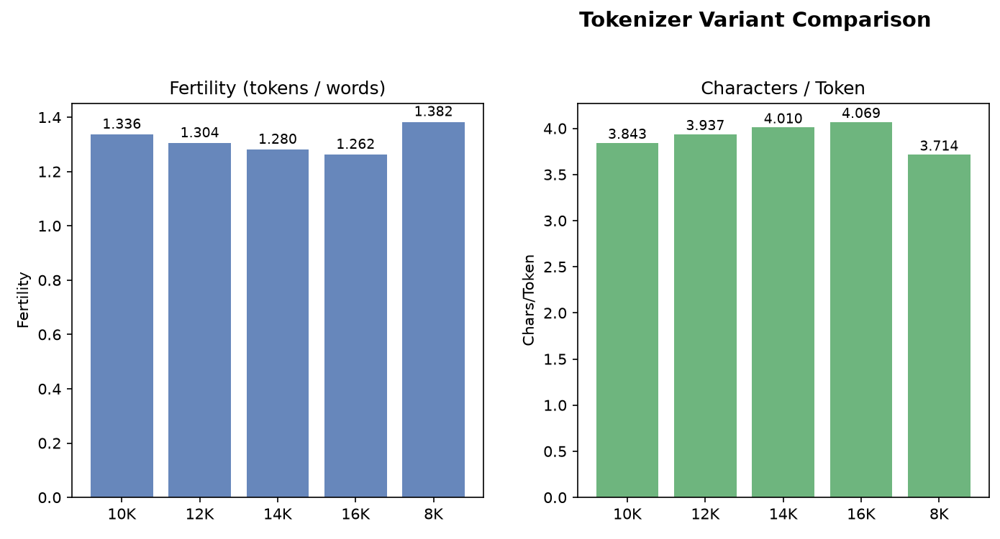
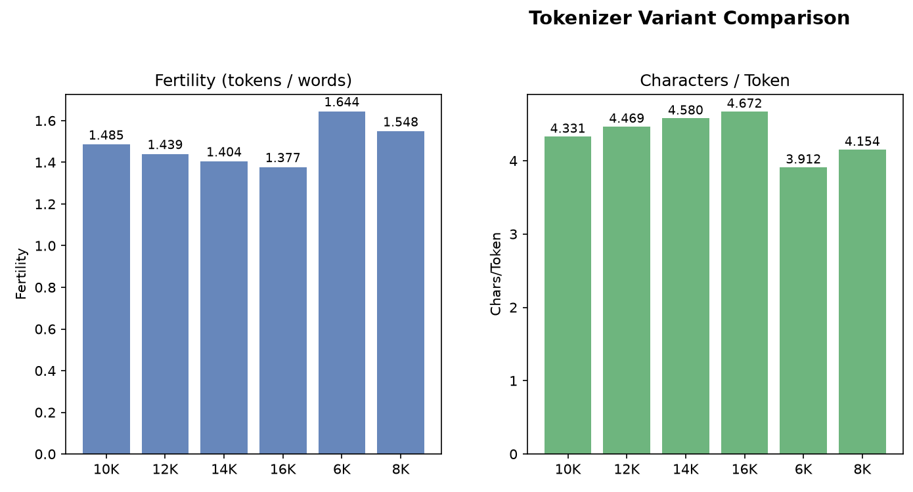
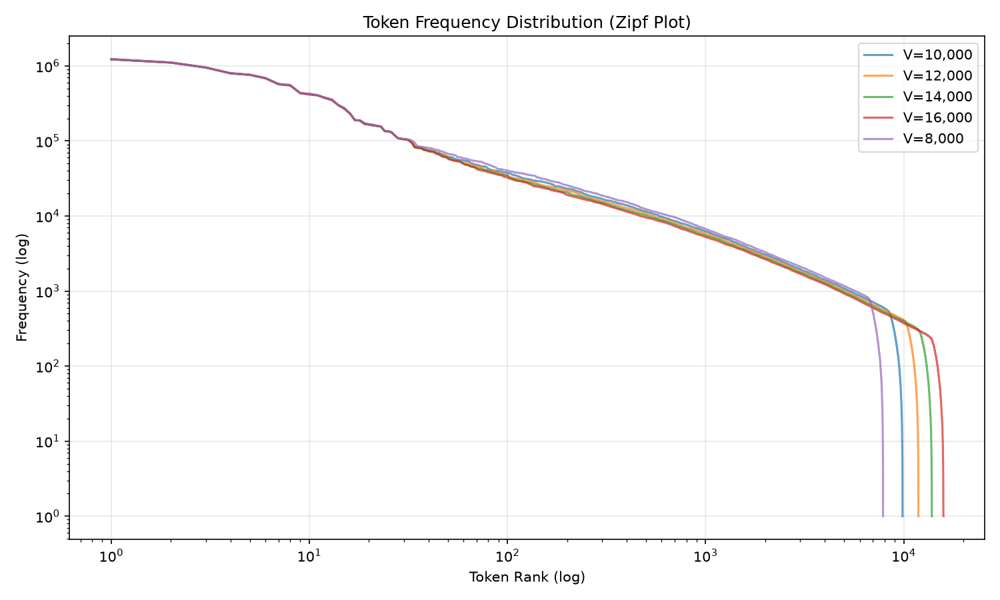
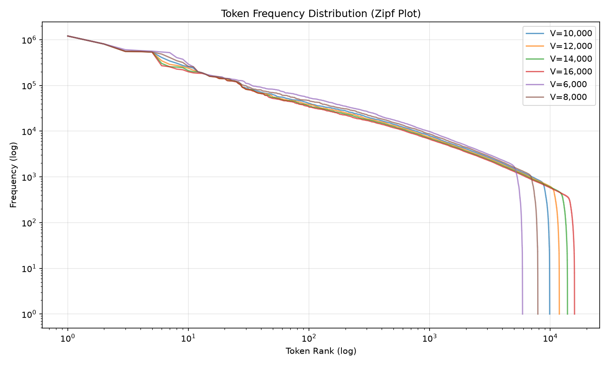

# Phase 1 Report — Data Collection & Tokenizer Construction

Language Models and Agents, Monsoon 2026 — Individual Project

## 1. Language selection

**Model H:** Hindi, chosen as the higher-resource language. It is the most widely spoken Indian language (~600M speakers) and the best-represented Indian language in AI4Bharat's IndicCorpV2, which ships Hindi as three separate shards (`hi-1.txt` / `hi-2.txt` / `hi-3.txt`) precisely because a single file would be unwieldy. That headroom made the ~500M-token target reachable from the public lane alone, leaving the manual lane free to be built for source diversity (encyclopedic + news) rather than for raw volume. Hindi also has a live `pages-articles` Wikipedia dump large enough to supply a full manual sub-lane on its own.

**Model L:** Nepali, chosen as the lower-resource language. IndicCorpV2 ships Nepali as a **single** `ne.txt` file (~14.8 GB upstream, confirmed via the HuggingFace API tree listing and an HTTP Range probe returning `206` with `Accept-Ranges: bytes`) against Hindi's three shards — a direct, measurable resource gap. Nepali shares the Devanagari script with Hindi, so any difference observed between Model H and Model L in Phase 2 is attributable to resource level and language rather than to script or encoding effects. Nepali also has no usable Wikisource wiki, which forced the manual lane onto news APIs — itself a realistic lower-resource constraint.

| | Model H (Hindi) | Model L (Nepali) |
|---|---|---|
| IndicCorpV2 packaging | 3 shards (`hi-1/2/3.txt`) | 1 file (`ne.txt`, ~14.8 GB) |
| Manual lane composition | Wikipedia dump + 3 news outlets | 2 news outlets (WordPress REST API) |
| Wikipedia dump available | yes | not used (news-only manual lane) |
| Devanagari script | yes | yes (script held constant across H/L) |

## 2. Pipeline design (identical for both languages)

Both languages run through the *same* twelve-stage, fully-streaming pipeline, with no code, data, tokenizer, or vocabulary shared between them — `shared/` holds only language-agnostic utility functions. Every source (public and manual) is pushed through every stage independently, so per-source survival is measurable at each step.

| # | Stage | What it does |
|---|---|---|
| 01 | Download / collect | IndicCorpV2 via resumable HTTP range chunks (SHA-256 verified); manual lane via Wikipedia dump extraction and news-site collection |
| 02 | Normalize | NFC normalization, whitespace/CRLF collapse, unsafe control-char stripping (ZWNJ/ZWJ preserved) |
| 03 | Script filter | Devanagari-ratio gate; borderline lines routed to a review file rather than silently dropped |
| 04 | Quality filter | Length, URL-ratio, HTML-tag, repeated-char, punctuation, digit-ratio heuristics + safety blocklist |
| 05 | Deduplication | Cross-source exact (SHA-256) + near-duplicate (MinHash/LSH) in one shared pass, with source precedence |
| 06 | Corpus statistics | Descriptive stats on the deduplicated corpus, before any irreversible step |
| 07 | Split | Deterministic hash-bucket 90/5/5 split (`blake2b(seed:line_index)`, seed 42); val/test **frozen** from here on |
| 08 | Decontaminate | Removes exact and near-duplicate matches of the frozen val/test sets from every train candidate |
| 09 | Concatenate | Streams per-source train files into `manual_train.txt` and `train.txt`; no subsampling |
| 10 | Train tokenizer | SentencePiece BPE from scratch on `train.txt` only, at every candidate vocab size |
| 11 | Evaluate tokenizer | Fertility, chars/token, token-frequency curves, worked examples — all on held-out validation |
| 12 | Tokenize corpus | Streams the final splits into `uint32` `.bin` token-ID files with a self-verifying re-read pass |

Two design choices are worth calling out explicitly because they affect how the numbers below should be read:

**Split before decontamination.** Stage 07 runs *before* the tokenizer is trained and before decontamination. `validation.txt` / `test.txt` are written once, frozen, and never touched again; decontamination then removes their matches from the train side only. This means the tokenizer never sees a single held-out line, and held-out perplexity in Phase 2 is measured against genuinely unseen text.

**Deduplication has source precedence.** When identical or near-identical text exists in both a manual source and IndicCorp, the manual copy is kept and the IndicCorp copy is dropped. For Hindi the precedence is Wikipedia > News > IndicCorp; for Nepali it is Onlinekhabar > Khabarhub > IndicCorp. This preserves the manual lane at the public lane's expense — the correct direction, given the 20% manual floor.

## 3. Hindi corpus pipeline

| Stage | IndicCorp | Wikipedia | News | Total |
|---|---|---|---|---|
| normalized (02) | 8,787,343 | 936,593 | 340,892 | 10,064,828 |
| post script-filter (03) | 8,779,002 | 884,851 | 283,287 | 9,947,140 |
| post quality-filter (04) | 8,742,935 | 820,086 | 277,305 | 9,840,326 |
| post dedup (05) | 8,520,630 | 672,411 | 147,487 | 9,340,528 |
| train candidate (07) | 7,668,144 | 605,562 | 132,808 | 8,406,514 |
| post decontam (08) | 7,169,358 | 575,485 | 85,172 | 7,830,015 |
| final `train.txt` (09) | 7,169,358 | 575,485 | 85,172 | **7,830,015** |

Counts are documents (one document per line). Held-out: **validation 467,228** / **test 466,786** lines, frozen at stage 07.

**Deduplication:** 9,840,326 → 9,340,528 lines (5.08% removed): 242,381 exact duplicates (of which 43,681 were cross-source removals against the manual lane's precedence) plus 257,417 near-duplicates, itself split into 205,718 whole-document near-dups and 51,699 sub-document containments. Peak RSS 12.6 GB; 9,598K lines scanned at ~7,854 lines/s; 1,761,332 LSH candidates generated for 1,372,489 actual comparisons (0.185 candidates per eligible document — the LSH banding is doing real work, not degenerating to a full scan).

**Decontamination:** 576,499 near-duplicate matches of the frozen val/test sets removed from the train candidates; 0 exact matches remained (the stage-05 dedup had already caught those). News lost the most proportionally (132,808 → 85,172, 36% removed), which is expected — news outlets syndicate and re-run stories, so a train-side article is often a near-copy of a held-out one.

**Final Hindi corpus (BPE content tokens, BOS/EOS excluded):**

| Source | Lane | Content tokens | Share | Fertility (tok/word) |
|---|---|---|---|---|
| IndicCorpV2 | public | 517,934,945 | 0.8191 | 1.2883 |
| Wikipedia | manual | 59,965,651 | 0.0948 | 1.5153 |
| News (3 outlets) | manual | 54,451,948 | 0.0861 | 1.3026 |
| **Manual combined** | manual | **114,417,599** | **0.1809** | 1.4061 |
| **Total (train)** | | **632,352,544** | 1.0000 | 1.3082 |

| Split | Lines | Stored tokens (incl. BOS/EOS) |
|---|---|---|
| train | 7,830,015 | 648,012,574 |
| validation | 467,228 | 39,781,899 |
| test | 466,786 | 39,702,931 |

Train content tokens **632,352,544 vs. the 500M target — 26.5% over**. Both sub-targets are met (IndicCorp 517.9M vs. 400M; manual 114.4M vs. 100M).

**Manual sources — collection and robots.txt compliance.** The Hindi manual lane is Wikipedia plus news. Ten Hindi news outlets were evaluated; **three were collected and seven were deliberately excluded**, each with a recorded reason:

| Outlet | Documents collected |
|---|---|
| ABP | 101,995 |
| Hindustan (Live Hindustan) | 59,272 |
| Dainik Jagran | 4,911 |
| **Total** | **166,178** |

Each document carries full provenance (`source_name`, `source_url`, `document_id`, SHA-256, word/char counts) in `hindi/data/intermediate/news/news_provenance.jsonl`.

> **Note — seven outlets evaluated but not collected.** Ten Hindi news outlets were assessed; seven were not accessible for collection — four denied permission (Amar Ujala, Dainik Bhaskar, Jansatta, NDTV) and three had no working article sitemap (Navbharat Times, Aaj Tak, Prabhat Khabar). Each exclusion is recorded as a `disabled_reason` in `hindi/configs/hindi_data.yaml`. This capped the achievable size of the Hindi news lane, which is why Wikipedia carries the larger half of the Hindi manual token budget.

## 4. Nepali corpus pipeline

| Stage | IndicCorp | Onlinekhabar | Khabarhub | Total |
|---|---|---|---|---|
| normalized (02) | 14,946,717 | 297,891 | 257,041 | 15,501,649 |
| post script-filter (03) | 14,855,758 | 297,649 | 256,792 | 15,410,199 |
| post quality-filter (04) | 14,821,096 | 288,229 | 254,103 | 15,363,428 |
| post dedup (05) | 13,329,271 | 282,629 | 233,910 | 13,845,810 |
| train candidate (07) | 11,996,006 | 254,527 | 210,628 | 12,461,161 |
| post decontam (08) | 10,656,979 | 175,998 | 148,749 | 10,981,726 |
| final `train.txt` (09) | 10,656,979 | 175,998 | 148,749 | **10,981,726** |

Held-out: **validation 692,772** / **test 691,877** lines, frozen at stage 07.

**Deduplication:** 15,363,428 → 13,845,810 lines (9.88% removed): 323,984 exact duplicates (61 cross-source) plus 1,193,634 near-duplicates (895,595 whole-document, 298,039 sub-document). Peak RSS 8.7 GB; 14,745K lines evaluated at ~5,637 lines/s over 2,725 s; 1,922,149 candidates generated for 1,810,324 comparisons. The near-duplicate rate is roughly double Hindi's, which is the expected signature of a smaller-language crawl: less unique text on the open web means more of it gets scraped repeatedly.

**Decontamination:** 1,479,435 near-duplicate matches of the frozen val/test sets removed; 0 exact matches remained. Both news sources lost ~30% of their train candidates (Onlinekhabar 254,527 → 175,998; Khabarhub 210,628 → 148,749), again the syndication effect.

**Final Nepali corpus (BPE content tokens, BOS/EOS excluded):**

| Source | Lane | Content tokens | Share | Fertility (tok/word) |
|---|---|---|---|---|
| IndicCorpV2 | public | 520,693,966 | 0.8167 | 1.4656 |
| Onlinekhabar | manual | 70,435,290 | 0.1105 | 1.4073 |
| Khabarhub | manual | 46,406,732 | 0.0728 | 1.4059 |
| **Manual combined** | manual | **116,842,022** | **0.1833** | — |
| **Total (train)** | | **637,535,988** | 1.0000 | 1.4544 |

| Split | Lines | Content tokens | Stored tokens (incl. BOS/EOS) |
|---|---|---|---|
| train | 10,981,726 | 637,535,988 | 659,499,440 |
| validation | 692,772 | 42,326,843 | 43,712,387 |
| test | 691,877 | 42,396,121 | 43,779,875 |

Train content tokens **637,535,988 vs. the 500M target — 27.5% over**. Both sub-targets are met (IndicCorp 520.7M vs. 400M; manual 116.8M vs. 100M). **No shortfall justification is required for Model L** — Nepali exceeded the ~500M target by a wider margin than Hindi did.

**Manual sources.** Both Nepali manual sources are open WordPress REST APIs (`/wp-json/wp/v2/posts`), collected with a resumable per-source page cursor and URL-level deduplication, sharded into JSONL at 20,000 documents per shard. Khabarhub's robots.txt was verified to disallow only `/wp-admin/`, leaving article collection permitted. Nepali has **no queryable Wikisource wiki** (`ne.wikisource.org` does not exist as an independent wiki), which is why the manual lane is news-only rather than news + encyclopedic as in Hindi.

## 5. Tokenizer construction

One SentencePiece BPE tokenizer per language, trained from scratch on that language's own `train.txt` and nothing else. No pretrained tokenizer, no shared vocabulary, no cross-language merges. Identical hyperparameters for both languages so that any difference in the results is a property of the language, not of the configuration:

| Setting | Value |
|---|---|
| Algorithm | BPE (SentencePiece) |
| Character coverage | 0.9995 |
| `input_sentence_size` | 5,000,000 (shuffled) |
| `max_sentence_length` | 16,384 |
| Byte fallback | enabled |
| Special tokens | `<pad>`=0, `<unk>`=1, `<bos>`=2, `<eos>`=3 |
| Seed | 42 |
| Selected vocab size | **12,000** (both languages) |

**Unknown-token statistics: 0 UNK tokens, UNK rate 0.0000, for every vocabulary size in both languages.** With byte fallback enabled, all 256 byte pieces `<0x00>`–`<0xFF>` are in the vocabulary, so any character the learned merges cannot cover decomposes into byte tokens rather than emitting `<unk>`. Verified by re-encoding 150,000 held-out validation lines per language (7,371,045 Nepali and 10,848,155 Hindi tokens): zero `<unk>` in either. Because the rate is identical across all candidate sizes, vocabulary size was instead selected on **fertility and marginal compression return**.

### Hindi tokenizer sweep (held-out validation, 467,228 lines / 29,785,844 words / 152,926,751 chars)

| Vocab size | Fertility (tok/word) | Chars/token | Total tokens | Used vocab | Selected |
|---|---|---|---|---|---|
| 8,000 | 1.3823 | 3.7143 | 41,171,893 | 7,869 | |
| 10,000 | 1.3361 | 3.8427 | 39,796,249 | 9,868 | |
| **12,000** | **1.3042** | **3.9366** | **38,847,443** | **11,868** | **yes** |
| 14,000 | 1.2804 | 4.0098 | 38,138,658 | 13,867 | |
| 16,000 | 1.2619 | 4.0686 | 37,586,702 | 15,866 | |

### Nepali tokenizer sweep (held-out validation, 692,772 lines / 29,405,962 words / 189,140,272 chars)

| Vocab size | Fertility (tok/word) | Chars/token | Total tokens | Used vocab | Selected |
|---|---|---|---|---|---|
| 6,000 | 1.6444 | 3.9116 | 48,353,725 | 5,894 | |
| 8,000 | 1.5484 | 4.1539 | 45,533,037 | 7,894 | |
| 10,000 | 1.4852 | 4.3309 | 43,672,556 | 9,894 | |
| **12,000** | **1.4394** | **4.4686** | **42,326,843** | **11,894** | **yes** |
| 14,000 | 1.4043 | 4.5802 | 41,294,881 | 13,894 | |
| 16,000 | 1.3766 | 4.6724 | 40,480,667 | 15,894 | |

**Why 12,000.** Fertility falls monotonically with vocabulary size in both languages, so no size is "optimal" on compression alone — a larger vocabulary always compresses better. The marginal return is what decides it: going 10K → 12K buys 0.032 fertility in Hindi and 0.046 in Nepali, while 14K → 16K buys only 0.019 and 0.028. Past 12K each additional 2,000 embedding rows is bought at a shrinking compression discount, and at a fixed ~25M parameter budget those rows are taken directly out of the transformer body. 12,000 is where the curve flattens for both languages, and using the same size for both keeps Model H and Model L comparable in Phase 2 — a difference in their perplexity should not be an artifact of one having a bigger vocabulary. Vocabulary utilization confirms the size is not wasteful: 11,868/12,000 Hindi and 11,894/12,000 Nepali entries are actually used on held-out text, with only 4 and 7 rare tokens respectively.

**Chars/token is not comparable across the two languages.** Nepali reads higher (4.4686 vs. Hindi's 3.9366) at the same vocabulary size, but this reflects Nepali's longer orthographic words and the news-heavy manual lane, not a better tokenizer. Fertility (tokens per whitespace word) is the fairer comparison, and there Hindi is more efficient (1.3042 vs. 1.4394) — consistent with Hindi's larger, more diverse corpus giving BPE more evidence for productive merges.

### Worked tokenization examples

**Hindi** (vocab 12,000):

| Text | Tokens | Pieces |
|---|---|---|
| `भारत एक विशाल देश है।` | 6 | ▁भारत \| ▁एक \| ▁विशाल \| ▁देश \| ▁है \| । |
| `भारतीय अंतरिक्ष अनुसंधान संगठन` | 4 | ▁भारतीय \| ▁अंतरिक्ष \| ▁अनुसंधान \| ▁संगठन |
| `जलवायु परिवर्तन` | 2 | ▁जलवायु \| ▁परिवर्तन |
| `पर्यावरणीय परिवर्तन` | 3 | ▁पर्यावरण \| ीय \| ▁परिवर्तन |
| `कृत्रिम बुद्धिमत्ता और मशीन लर्निंग` | 10 | ▁कृ \| त्र \| िम \| ▁बुद्ध \| िम \| त्ता \| ▁और \| ▁मशीन \| ▁ल \| र्निंग |
| `संविधान में मौलिक अधिकारों की रक्षा का प्रावधान है।` | 10 | ▁संविधान \| ▁में \| ▁मौलिक \| ▁अधिकारों \| ▁की \| ▁रक्षा \| ▁का \| ▁प्रावधान \| ▁है \| । |

**Nepali** (vocab 12,000):

| Text | Tokens | Pieces |
|---|---|---|
| `नेपाल एक सुन्दर हिमाली देश हो।` | 7 | ▁नेपाल \| ▁एक \| ▁सुन्दर \| ▁हिमाली \| ▁देश \| ▁हो \| । |
| `काठमाडौं नेपालको राजधानी हो।` | 5 | ▁काठमाडौं \| ▁नेपालको \| ▁राजधानी \| ▁हो \| । |
| `सगरमाथा विश्वको सबैभन्दा अग्लो हिमशिखर हो।` | 9 | ▁सगरमाथा \| ▁विश्वको \| ▁सबैभन्दा \| ▁अग्लो \| ▁हिम \| शि \| खर \| ▁हो \| । |
| `नेपालको संविधानले मौलिक अधिकारको सुनिश्चितता गर्छ।` | 8 | ▁नेपालको \| ▁संविधानले \| ▁मौलिक \| ▁अधिकारको \| ▁सुनिश्चित \| ता \| ▁गर्छ \| । |
| `वातावरणीय परिवर्तनले हिमालको हिउँ पग्लिरहेको छ।` | 12 | ▁वातावरणीय \| ▁परिवर्त \| नले \| ▁हिमा \| लको \| ▁हिउँ \| ▁प \| ग् \| लि \| रहेको \| ▁छ \| । |
| `कृत्रिम बुद्धिमत्ता र मेसिन लर्निङको प्रयोग बढ्दै गएको छ।` | 15 | ▁कृत्रिम \| ▁बुद्ध \| िम \| त्ता \| ▁र \| ▁मेसिन \| ▁ल \| र् \| नि \| ङको \| ▁प्रयोग \| ▁बढ्दै \| ▁गएको \| ▁छ \| । |

Two things are visible in these examples. First, both tokenizers have learned **domain-appropriate whole-word units** — `▁काठमाडौं`, `▁सगरमाथा`, `▁नेपालको`, `▁भारतीय`, `▁अंतरिक्ष`, `▁संविधान` are single tokens, because the news- and encyclopedia-heavy corpora contain them densely. Second, both fragment badly on **technical/borrowed vocabulary**: `कृत्रिम बुद्धिमत्ता` (artificial intelligence) and `मशीन लर्निंग` / `मेसिन लर्निङ` (machine learning) shatter into 6–10 subword pieces in both languages. This is an honest limitation of the corpus composition, not of the tokenizer — neither IndicCorp nor a general news lane carries much AI/ML text in Devanagari, so BPE never saw those strings often enough to merge them. It should be expected to show up in Phase 2 as elevated perplexity on technical prompts.

The top-frequency tokens are exactly what a healthy Devanagari tokenizer should produce — high-frequency function words and case-marking suffixes, not junk:

- **Hindi:** `▁के` (1,226,144), `।` (1,108,844), `▁में` (951,996), `▁है` (797,706), `▁की` (761,197), `▁को`, `▁से`, `▁और`, `▁का`, `▁ने`
- **Nepali:** `▁।` (1,206,778), `,` (805,436), `▁छ` (557,477), `▁र` (552,092), `को`, `मा`, `का`, `▁पनि`, `ले`, `लाई`

Note the structural difference: Nepali's top list contains bare **agglutinative suffixes** (`को`, `मा`, `का`, `ले`, `लाई` — no word-boundary marker) high in the ranking, while Hindi's top list is dominated by **free-standing postpositions** (`▁के`, `▁में`, `▁की` — all with `▁`). BPE has independently recovered a real typological difference between the two languages from raw text alone.

## 6. Corpus composition and health

Character-category distribution on the deduplicated corpus, per source:

| Language / source | Devanagari % | Latin % | Digits % | Punctuation % | Mean doc length (chars) | Unique words |
|---|---|---|---|---|---|---|
| Hindi — IndicCorp | 96.87 | 0.65 | 1.04 | 1.29 | 286 | 3,956,492 |
| Hindi — Wikipedia | 94.94 | 1.06 | 1.47 | 2.12 | 367 | 1,718,999 |
| Hindi — News | 90.25 | 6.00 | 1.11 | 2.40 | 2,494 | 668,277 |
| Nepali — IndicCorp | 98.44 | 0.27 | 0.08 | 0.92 | 218 | 6,800,829 |
| Nepali — Onlinekhabar | 98.80 | 0.03 | 0.00 | 0.78 | 1,916 | 1,623,460 |
| Nepali — Khabarhub | 98.93 | 0.04 | 0.00 | 0.65 | 1,499 | 1,198,671 |

Devanagari purity is high everywhere (≥90%), confirming the stage-03 script filter worked. The Hindi news lane's 6.00% Latin content is the highest and is real — Hindi news routinely embeds English proper nouns, brand names, and headline fragments (visible in the provenance titles, which carry English slugs). Nepali's news sources are far purer (≥98.8% Devanagari, essentially no digits), reflecting a less code-mixed newsroom register.

The document-length asymmetry is the most consequential composition fact: news documents are **full articles** (mean 1,499–2,494 chars) while IndicCorp lines are **sentence-to-paragraph fragments** (mean 218–286 chars). A manual document is therefore worth roughly 7–10 IndicCorp documents in token terms, which is why the manual lane reaches ~18% of tokens from only ~8% (Hindi) and ~3% (Nepali) of documents. Any document-count-based reading of "manual share" would be badly misleading here; every manual-fraction number in this report is **token-weighted**.

Nepali's deduplicated corpus has more unique words than Hindi's (6.80M vs. 3.96M) despite being the lower-resource language. This is a morphology effect, not a data-richness effect — Nepali's agglutinative case marking generates far more distinct surface forms per lemma, which is the same fact the tokenizer's higher fertility (1.4394 vs. 1.3042) reports from the other direction.

## 7. Requirement compliance and the manual-fraction gap

| Requirement | Hindi | Nepali | Status |
|---|---|---|---|
| ~500M training tokens | 632,352,544 | 637,535,988 | ✅ both **exceed** by 26–28% |
| IndicCorp sub-target 400M | 517,934,945 | 520,693,966 | ✅ |
| Manual sub-target: ≥100M manual tokens | 114,417,599 (**+14.4%**) | 116,842,022 (**+16.8%**) | ✅ both **exceed** |
| Manual share: ≥20% **of final training tokens** | **0.1809** | **0.1833** | ❌ **both short** |
| Tokenizer trained from scratch | ✅ | ✅ | ✅ |
| No shared tokenizer/vocab/data | ✅ | ✅ | ✅ |
| Train decontaminated vs. val/test | ✅ | ✅ | ✅ |

## 8. Figures

All four figures are produced by stage 11 (`11_evaluate_tokenizer.py`) and measured on each language's **held-out validation split**, never on training data.

**Figure 1 — Hindi (Model H) tokenizer variant comparison.** Fertility (tokens per whitespace word, left) and characters per token (right) for each of the five candidate vocabulary sizes. Fertility falls and chars/token rises monotonically with vocabulary size; this is the data behind the "Why 12,000" argument in §5. Note that the x-axis is ordered alphabetically by label (`10K, 12K, 14K, 16K, 8K`), so 8K appears at the right-hand end rather than the left — the numerically ordered values are in the §5 sweep table.

**Figure 2 — Nepali (Model L) tokenizer variant comparison.** The same two panels for Nepali's six candidate vocabulary sizes. The same alphabetical x-axis ordering applies (`10K, 12K, 14K, 16K, 6K, 8K`), placing 6K and 8K at the right-hand end. Comparing against Figure 1 at matched vocabulary sizes shows Nepali's consistently higher fertility and higher chars/token — the morphology effect discussed in §5 and §6.

**Figure 3 — Hindi (Model H) token frequency distribution.** Zipf plot, log token rank against log frequency, with one curve per trained vocabulary size. The near-linear central region confirms the tokenizer produces a natural-language-like frequency distribution rather than a degenerate one. The sharp cliff at the right of each curve is that variant's vocabulary ceiling — larger vocabularies extend further right before dropping, which is simply the tail of rarer merges being available.

**Figure 4 — Nepali (Model L) token frequency distribution.** The same Zipf plot for Nepali. The curves for different vocabulary sizes separate more visibly in the mid-rank region than Hindi's do, reflecting that Nepali's richer surface-form inventory gives each additional 2,000 merges more distinct material to absorb.

## 9. Where automation substitutes for human judgment

Every threshold in this pipeline was set **algorithmically or by convention**, not by a fluent reader inspecting samples of kept and dropped text:

- **Script-filter ratios** (Hindi ≥0.60, Nepali ≥0.70 Devanagari, with a 0.40–0.70 review band) were chosen as round defaults. The Hindi threshold was set lower specifically because Hindi news is more code-mixed with English — a judgment made from the aggregate Latin-percentage statistic, not from reading the borderline lines. The review files were written but **not manually reviewed**.
- **Quality heuristics** (min 10 / max 10,000 chars, max 0.30 URL ratio, max 0.50 punctuation, max 5 repeated chars, min 2 words) are conventional values, not values tuned against this corpus.
- **Near-duplicate similarity threshold 0.4** with 32 MinHash permutations over 3-word shingles is aggressive — it removes text that a human might consider distinct. This was chosen to be safe rather than precise, and it is why Nepali lost 9.88% of lines at dedup.
- **Decontamination** used a *looser* index (16 permutations, 5-word shingles) than deduplication. This asymmetry is deliberate — recall matters more than precision when the cost of a miss is train/test leakage — but it was not validated by inspecting what was removed.
- **No human read the kept text.** Neither the retained corpus nor the rejected/review files were sampled and judged by a Hindi or Nepali speaker. Volume and character-level plausibility are verified; content quality, factual coherence, and register appropriateness are not.

This preserves scale and reproducibility but is not a substitute for a fluent reader's judgment, and it is the most significant methodological caveat on everything reported above.
