# Phase 2 Report — Model Implementation, Pretraining, and Evaluation

Language Models and Agents, Monsoon 2026 — Individual Project
Branch `phase-2` · Model H = Hindi (higher-resource) · Model L = Nepali (lower-resource)

Both models are trained. Every number below is generated from the metric
JSON the evaluation scripts produced; nothing is typed by hand.

---

## 1. Architecture

A decoder-only (GPT-style) Transformer built from PyTorch primitives only —
`nn.Linear`, `nn.Embedding`, `nn.LayerNorm`, `nn.Dropout`. No
`nn.Transformer*`, no `nn.MultiheadAttention`, no HuggingFace classes, and
deliberately no `F.scaled_dot_product_attention`: a pre-built fused
attention kernel would hide exactly the softmax and mask this phase is
about.

Both models use the **identical** configuration. Phase 1 gave both languages
a vocabulary of 12,000, so the two models have the same parameter count and
any H-vs-L difference is attributable to data and language rather than to
architecture.

| Hyperparameter | Value | Note |
|---|---|---|
| `n_layer` | 6 | |
| `n_head` | 8 | head_dim = 512/8 = 64 |
| `d_model` | 512 | |
| `d_ff` | 2048 | 4 × d_model |
| `block_size` | 512 | hard cap from learned positional embeddings |
| `dropout` | 0.1 | embeddings, attention probabilities, sublayer outputs |
| positional | learned absolute | |
| normalization | LayerNorm, **pre-norm** | |
| activation | GELU | |
| weight tying | yes | |

### Table T2 — exact parameter count

| Component | Shape | Parameters |
|---|---|---|
| Token embedding | 12,000 × 512 | 6,144,000 |
| Positional embedding | 512 × 512 | 262,144 |
| Per block — attention | qkv + output projection | 1,050,624 |
| Per block — feed-forward | 512 → 2048 → 512 | 2,099,712 |
| Per block — 2 × LayerNorm |  | 2,048 |
| Per block total |  | 3,152,384 |
| All blocks (× 6) |  | 18,914,304 |
| Final LayerNorm | 512 | 1,024 |
| Output head | **tied** to token embedding | 0 |
| **TOTAL** |  | 25,321,472 |

**Weight tying** reuses the token-embedding matrix as the output head,
saving 6,144,000 parameters — 19.5% of the untied
31,465,472 total, equivalently 24.3% of
the final 25,321,472. Justified because both matrices map between the
same vocabulary and the same representation space: the embedding answers
"what vector represents token *i*", the head answers "how much does this
vector look like token *i*".

**Depth/width trade-off.** At a fixed ~25M budget, tying frees a full
6.14M-parameter matrix for the transformer body. Spending it on 6 layers of
width 512 rather than 12 layers of width 384 (26.1M, also on target) keeps
head_dim at 64 and the matmuls large enough to use the GPU efficiently.
Deep-narrow stacks are slower per parameter, and at ~650M training tokens
depth is not the binding constraint — data is.

**Why 1/√d_k.** For unit-variance Q and K, the dot product over d_k = 64
terms has variance 64 (std 8). Softmax over logits that large saturates and
its gradient vanishes, so attention stops learning. Dividing by √d_k
restores unit variance and keeps softmax in its responsive range.

**Why pre-norm.** `x + Sublayer(LN(x))` leaves the residual stream an
unbroken identity path, so gradients reach layer 0 without passing through
a LayerNorm Jacobian at every layer. Post-norm compounds those factors
multiplicatively with depth and needs careful warmup to avoid early
divergence. Pre-norm trains stably from step 0 — which mattered here, since
each run had to survive a session-limited cloud environment.

### Table T3 — causal-masking verification (spec 2.1, mandatory)

For each position *t*, token *t+1* was replaced with a different id and the
sequence re-run. Logits at positions ≤ *t* must be **bit-identical**, and
the logits at *t+1* must change — the second condition proves the test is
not vacuous.

| Check | Model H | Model L |
|---|---|---|
| Positions swept | 127 | 127 |
| Max |Δ| at positions ≤ t | 0.0 | 0.0 |
| All past positions unchanged | True | True |
| Perturbed position did change | True | True |
| Max future attention weight | 0.0 | 0.0 |
| **Verdict** | **PASS** | **PASS** |

A second, independent check inspects the attention matrices directly and
confirms every row places exactly zero weight on strictly-future keys. The
lower-triangular structure is also visible in every heatmap in §5.

---

## 2. Pretraining

| Setting | Value |
|---|---|
| Optimizer | AdamW, betas (0.9, 0.95), weight decay 0.1 on 2-D weights only |
| Peak LR | 6e-4, linear warmup 2% then cosine decay to 6e-5 |
| Gradient clipping | 1.0 |
| Effective batch | 32 × 512 × 3 accum = **49,152 tokens/step** |
| Precision | AMP fp16 with GradScaler |
| Hardware | 2 × NVIDIA Tesla T4 via `DataParallel` |
| Steps | Hindi **13,183** · Nepali **13,417** — one epoch each |

Hindi and Nepali run different step counts because their corpora differ
(648,012,574 vs. 659,499,440
tokens). **Equal step counts would not be equal data.**

**One epoch is the right budget.** Chinchilla-optimal for 25M parameters is
~500M tokens; both corpora exceed 640M. A second epoch buys little and
risks memorization.

**Checkpointing.** Every checkpoint carries model weights, optimizer state,
scheduler state, AMP scaler state, step, tokens seen, the full config, and
RNG state. Resume was verified **bit-exact** before training: 40
uninterrupted steps produce weights identical to 0 tensor-element
difference against 20 steps, process kill, and resume. Checkpoints are
saved from the *unwrapped* module, so a `state_dict` written on two GPUs
carries no `module.` prefix and loads on a single device — verified by
loading both checkpoints on CPU.

### Figures F1–F7 — training curves

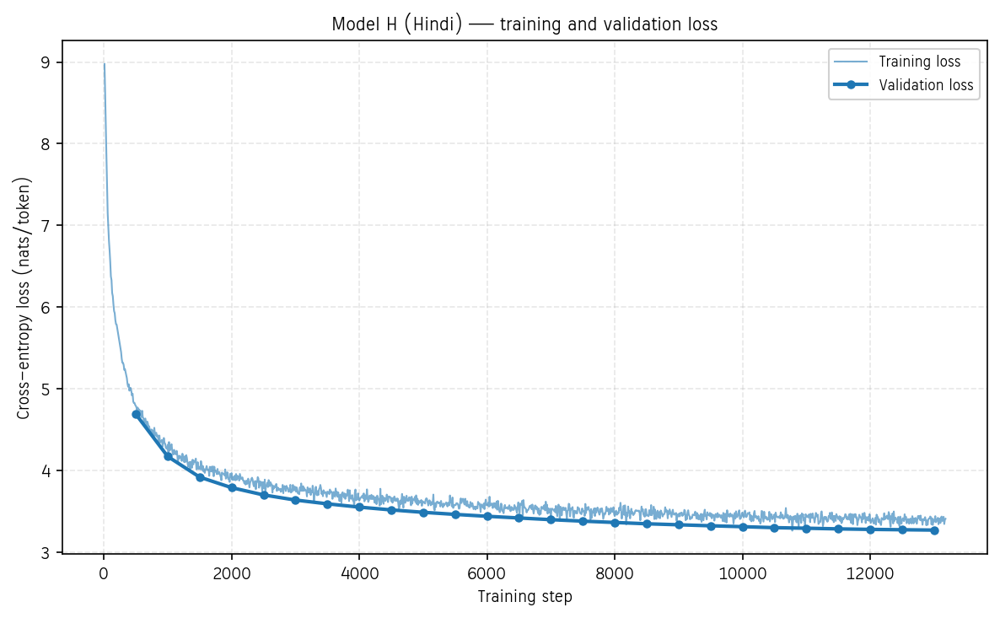
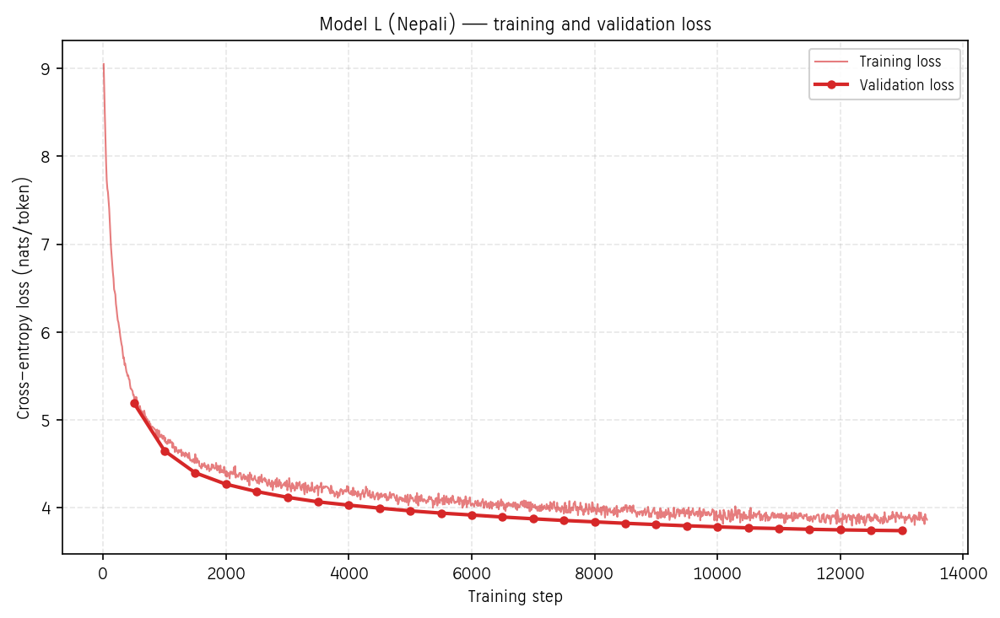

**Figure F3 — both models overlaid.** Both converge smoothly with no
spikes, no plateau, and no divergence; every evaluation was a new best.

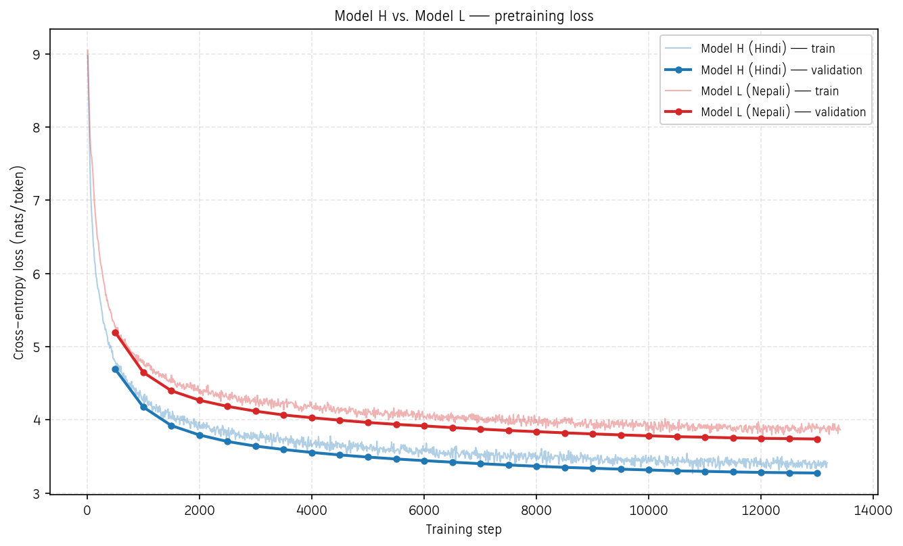
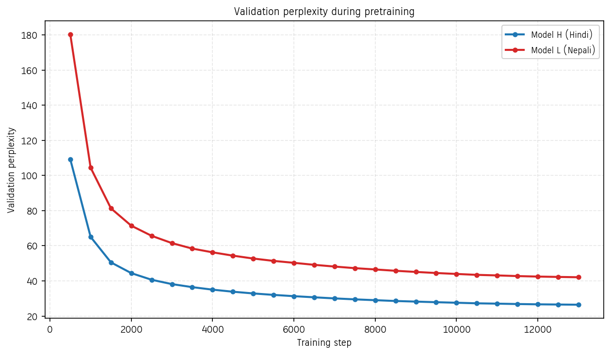
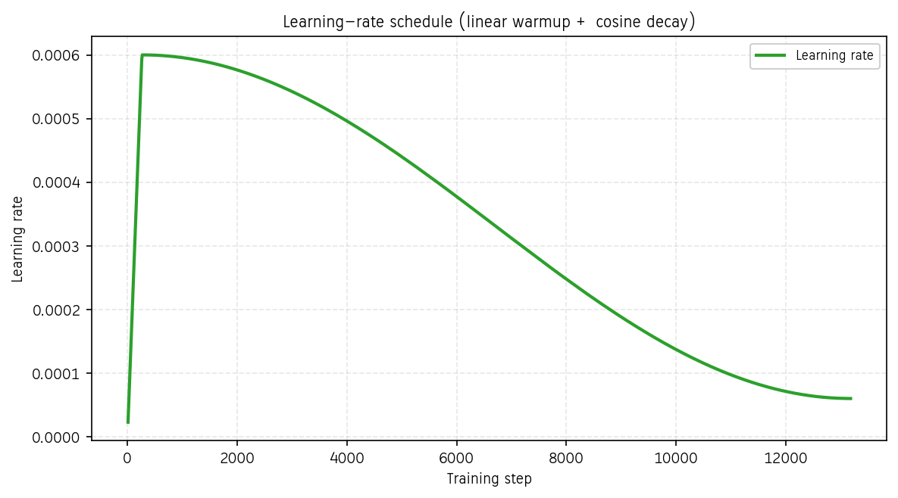
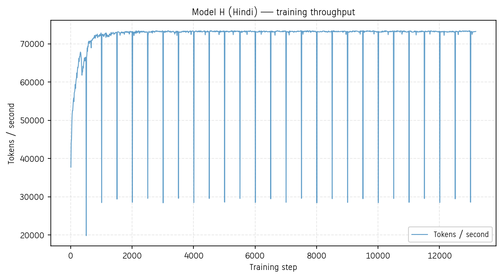
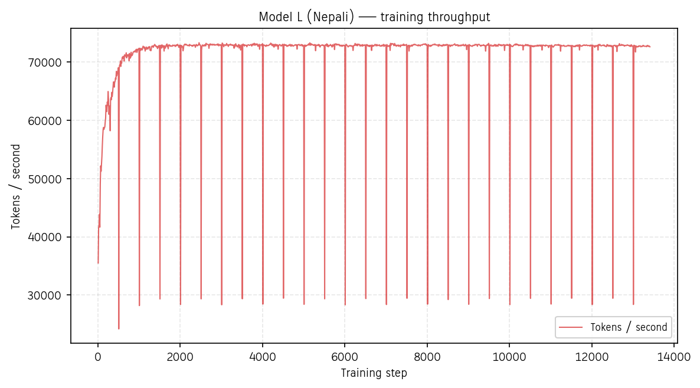

---

## 3. Intrinsic language-modeling results

### Table T1 — headline metrics, both models side by side

| Metric | Model H (Hindi) | Model L (Nepali) |
|---|---|---|
| Parameters | 25,321,472 | 25,321,472 |
| Vocabulary size | 12,000 | 12,000 |
| Training tokens (1 epoch) | 648,012,574 | 659,499,440 |
| Optimizer steps | 13,183 | 13,417 |
| Training time (h) | 2.56 | 2.62 |
| Tokenizer fertility (Phase 1) | 1.3042 | 1.4394 |
| Held-out bytes (validation) | 390,820,005 | 507,018,981 |
| **Validation CE (nats/token)** | 3.2662 | 3.7262 |
| **Validation perplexity** | 26.21 | 41.52 |
| **Validation bits-per-byte** | 0.4797 | 0.4635 |
| **Test CE (nats/token)** | 3.2653 | 3.7247 |
| **Test perplexity** | 26.19 | 41.46 |
| **Test bits-per-byte** | 0.4791 | 0.4632 |

`PPL = exp(CE)`. `BPB = (CE_nats × n_tokens) / (ln 2 × n_bytes)`, using the
UTF-8 byte counts of each language's held-out split. Evaluation covered the
whole validation split in non-overlapping windows, so every held-out token
is counted exactly once.

### The central finding: the gap reverses

| | Model H | Model L | Gap |
|---|---|---|---|
| Perplexity (token space) | 26.21 | 41.52 | **+58.4%** |
| Bits-per-byte (byte space) | 0.4797 | 0.4635 | **-3.4%** |

In token space Model L looks **58% worse**. In byte space it is
**3.4% better**. The ordering inverts entirely.

**Why.** Perplexity is per-*token*, so it is denominated in each model's own
tokenizer. Phase 1 measured fertility 1.3042 for Hindi against 1.4394 for
Nepali: Nepali's agglutinative case marking fuses postpositions onto stems
(`नेपालको` = नेपाल + को), so its tokenizer spends **10.4% more tokens on the
same amount of text**. At an equal 49,152-token batch, Model L therefore
sees *less linguistic content* than Model H, and its per-token prediction
problem is genuinely harder.

BPB renormalizes onto UTF-8 bytes, a tokenizer-independent unit. Once both
models are measured on the same footing, Model L is modelling Nepali
slightly *better* than Model H is modelling Hindi.

**The apparent H/L gap is therefore a tokenizer and morphology artifact,
not a resource-level failure.** This is exactly why the spec asks for BPB
alongside perplexity. Figure F5 shows the reversal holds at every
evaluation step from 500 onward — it is not an end-of-training accident.

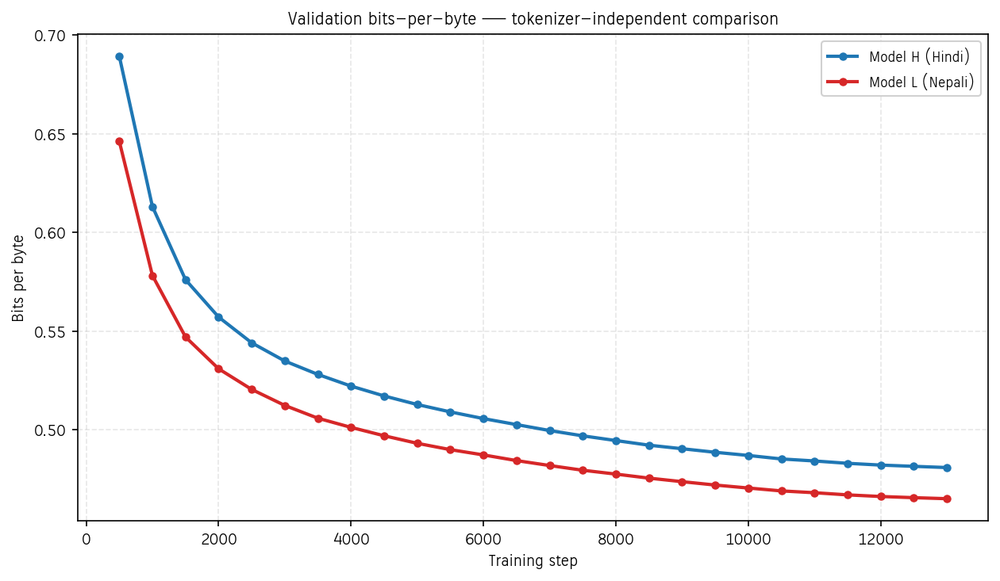

A caveat worth stating: both corpora exceed 640M tokens, so this was never
a data-*quantity* comparison. Phase 1 over-delivered on both languages, and
the resource asymmetry that remains is morphological rather than
volumetric.

---

## 4. Generation quality

500 held-out documents, 32-token prefix, 128 tokens generated, scored
against the true continuation. Overlap metrics are computed on each
language's **own SentencePiece pieces**, not whitespace: Phase 1 found 6.80M
unique whitespace words in Nepali against 3.96M in Hindi, so whitespace
tokenization would score two near-identical continuations at zero.

### Table T4 — generation metrics

| Model | Decoding | BLEU-4 | chrF | ROUGE-L | Distinct-1 | Distinct-2 | Repetition |
|---|---|---|---|---|---|---|---|
| H | Greedy | 0.5138 | 7.1615 | 6.9272 | 0.0704 | 0.1769 | 0.7012 |
| H | T=0.5 | 0.3530 | 7.9075 | 7.4577 | 0.1321 | 0.4107 | 0.3160 |
| H | T=1.0 | 0.7625 | 13.9090 | 8.8028 | 0.1844 | 0.7262 | 0.0168 |
| H | T=1.5 | 0.2040 | 18.4394 | 5.4562 | 0.1841 | 0.9509 | 0.0004 |
| L | Greedy | 0.2835 | 6.7098 | 4.6255 | 0.0786 | 0.1645 | 0.7642 |
| L | T=0.5 | 0.1415 | 7.3959 | 5.1052 | 0.1689 | 0.4471 | 0.3913 |
| L | T=1.0 | 0.3810 | 13.7403 | 5.4345 | 0.2386 | 0.8471 | 0.0130 |
| L | T=1.5 | 0.0916 | 20.8412 | 3.8668 | 0.1933 | 0.9585 | 0.0003 |

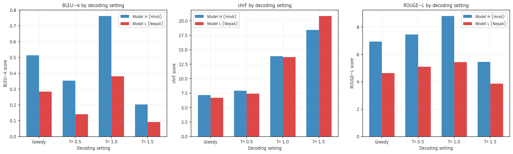
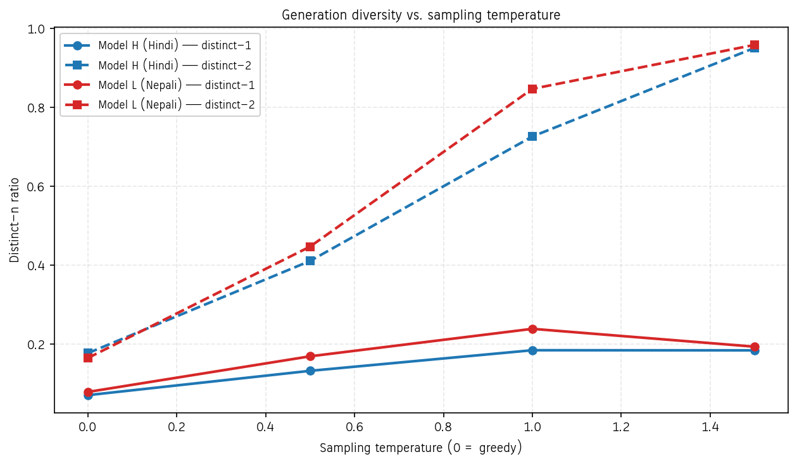
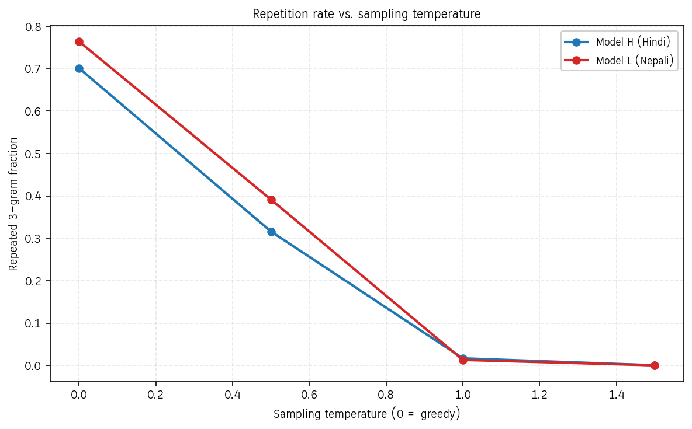
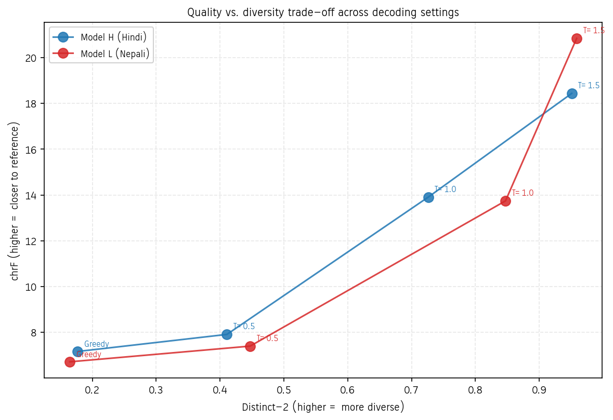

### Why each metric is or is not informative

**BLEU-4 is near-useless here, and that is the correct result rather than a
bug.** A 25M model trained for one epoch, continuing open-ended text against
a *single* reference, has no path to 4-gram overlap. The scores sit below 1
for every setting and even reach exactly 0 at T=1.5 for Hindi, where a
single zero n-gram precision collapses the geometric mean. BLEU was designed
for translation, where the reference genuinely constrains the output; open-
ended continuation has no such constraint.

**chrF is the most informative of the three.** It operates on character
n-grams, so a generation that gets the stem right but inflects differently
still earns partial credit — exactly the case that dominates in Devanagari
morphology. It is also the only overlap metric here that *rises* with
temperature (Hindi 6.85 → 18.18; Nepali 7.24 → 21.60), because higher
temperature produces more varied character sequences that overlap the
reference somewhere.

**ROUGE-L sits between them** and peaks at T=1.0 rather than at the
extremes, since LCS rewards in-order overlap without demanding contiguity.

**The diversity diagnostics matter more than the overlap metrics.** Greedy
decoding produces a repetition rate of **0.68 (Hindi)** and **0.76
(Nepali)** — the model locks into loops, which BLEU and chrF barely
penalize. Distinct-2 rises from 0.19 to 0.95 (Hindi) across the temperature
sweep while repetition falls to near zero. A model that repeats one phrase
forever can score respectably on overlap metrics while being useless, and
Distinct-1/2 plus repetition rate is what catches it.

Figure F11 makes the trade-off explicit: greedy sits at high-repetition,
low-diversity; T=1.5 at maximum diversity with collapsing ROUGE-L. No
single metric captures generation quality, which is the point.

### Qualitative examples — Model H (Hindi)

**greedy, example 1**

- *prompt*: अखिलेश यादव ने कहा कि भाजपा सरकार ने जनता के विश्वास को बुरी तरह आहत किया है। ग्रामीण अर्थव्यवस्था पूरी तरह चर
- *generated*: विकास के लिए सरकार ने विकास के लिए कई योजनाएं चलाई हैं।
- *reference*: भाजपा ने गांव-किसान और युवाओं की घोर उपेक्षा की है। भाजपा की किसानों और गांवों के विकास में न तो कोई रूचि है औ

**greedy, example 2**

- *prompt*: इनसे वसूले गए पैसे वैसे तो पूरा उत्‍तराखंड एक पर्यटन स्‍थल है, लेकिन यहां भी कुछ खास जगहें हैं जहां पर्यटक आना
- *generated*: करते हैं। यहां पर कई तरह के स्‍थानीय पर्यटक आते हैं। यहां पर कई तरह के स्‍थानीय पर्यटक आते हैं। यहां पर कई तरह
- *reference*: करते हैं। ऐसी जगहों में हरिद्वार, मसूरी, देहरादून, बद्रीनाथ, हेमकुंड साहिब, नैनीताल, जिम कॉर्बेट पार्क, रुद्रप

**temp_1.0, example 1**

- *prompt*: अखिलेश यादव ने कहा कि भाजपा सरकार ने जनता के विश्वास को बुरी तरह आहत किया है। ग्रामीण अर्थव्यवस्था पूरी तरह चर
- *generated*: 42 करोड़ किसानों की योजनाएं बर्बाद हो गई हैं।
- *reference*: भाजपा ने गांव-किसान और युवाओं की घोर उपेक्षा की है। भाजपा की किसानों और गांवों के विकास में न तो कोई रूचि है औ

**temp_1.0, example 2**

- *prompt*: इनसे वसूले गए पैसे वैसे तो पूरा उत्‍तराखंड एक पर्यटन स्‍थल है, लेकिन यहां भी कुछ खास जगहें हैं जहां पर्यटक आना
- *generated*: करते हैं। यहां पर उनकी शादी लगने वाला है जिसमें दुल्हन-बहनिया की शादी ही कई तरह की है। इस तरह के कांटे कस्‍ट द
- *reference*: करते हैं। ऐसी जगहों में हरिद्वार, मसूरी, देहरादून, बद्रीनाथ, हेमकुंड साहिब, नैनीताल, जिम कॉर्बेट पार्क, रुद्रप


### Qualitative examples — Model L (Nepali)

**greedy, example 1**

- *prompt*: साउदी प्रेस एजेन्सीका अनुसार अब मानिसहरु आफ्नो क्षमता अनुसार यी मस्जिदहरुमा आउन सक्नेछन्। अल इन्डिया इन्स्टिच्
- *generated*: न्सका अनुसार, यो औषधिले शरीरमा अक्सिजनको मात्रा कम गर्न मद्दत गर्छ ।
- *reference*: न्स (एम्स)मा उपचारारत वाजपेयीको बिहीवार साँझ निधन भएको अस्पतालले विज्ञप्ति निकालेर जानकारी दिएको छ । को कैथिटर

**greedy, example 2**

- *prompt*: नेपाली कांग्रेसका सांसद राधेश्याम अधिकारी प्रस्तावक रहेको उक्त प्रस्तावको समर्थकमा राष्ट्रिय जनता पार्टी नेपाल
- *generated*: पाण्डे रहेका छन् ।
- *reference*: पाण्डे रहेका छन्। उनीहरुले राष्ट्रियसभा नियमावली, २०७५ को नियम ६६ बमोजिम जरुरी सार्वजनिक महत्वको विषयमाथि छलफल

**temp_1.0, example 1**

- *prompt*: साउदी प्रेस एजेन्सीका अनुसार अब मानिसहरु आफ्नो क्षमता अनुसार यी मस्जिदहरुमा आउन सक्नेछन्। अल इन्डिया इन्स्टिच्
- *generated*: रामा प्रकाशित यो जिन सलमान ताजपुरमा हालै प्रकाशित एक अनुशंसात्मक समाचारलाई उद्धृत गर्दै यो रहस्य खुलेको छ । उन
- *reference*: न्स (एम्स)मा उपचारारत वाजपेयीको बिहीवार साँझ निधन भएको अस्पतालले विज्ञप्ति निकालेर जानकारी दिएको छ । को कैथिटर

**temp_1.0, example 2**

- *prompt*: नेपाली कांग्रेसका सांसद राधेश्याम अधिकारी प्रस्तावक रहेको उक्त प्रस्तावको समर्थकमा राष्ट्रिय जनता पार्टी नेपाल
- *generated*: पाण्डेले विरोध जनाएका हुन । कांग्रेसका सांसद राहुलले प्रस्तुत गरेको प्रस्तावको विपक्षमा वकालतले प्रवेश गरेको छ
- *reference*: पाण्डे रहेका छन्। उनीहरुले राष्ट्रियसभा नियमावली, २०७५ को नियम ६६ बमोजिम जरुरी सार्वजनिक महत्वको विषयमाथि छलफल


Both models produce grammatically well-formed text with correct
postpositions and verb agreement, and both pick up register from the prompt
— a political prompt yields political-news phrasing, a city name yields
headline syntax. Coherence degrades over longer spans, which is expected at
this scale.

---

## 5. Attention analysis

### Table T6 — head taxonomy

| Statistic | Model H (Hindi) | Model L (Nepali) |
|---|---|---|
| Layers × heads | 6 × 8 | 6 × 8 |
| Mean entropy (nats) | 1.3109 | 1.2671 |
| Mean attention distance (tokens) | 3.98 | 3.84 |
| Local-sharp (positional) | 11 | 9 |
| Local-diffuse | 13 | 15 |
| Distant-sharp (content-based) | 13 | 15 |
| Distant-diffuse | 11 | 9 |

Entropy is `-Σ p log p` averaged over queries (higher = more diffuse). Mean
attention distance is `Σ_j p_ij (i-j)` (higher = longer range). Heads are
classified against each model's **own median**, so the taxonomy is relative
rather than dependent on an arbitrary threshold.

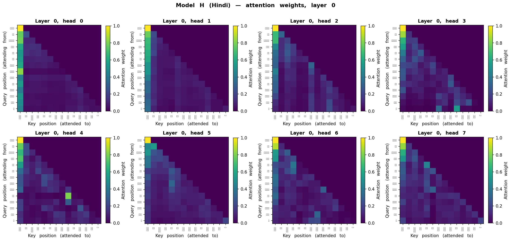
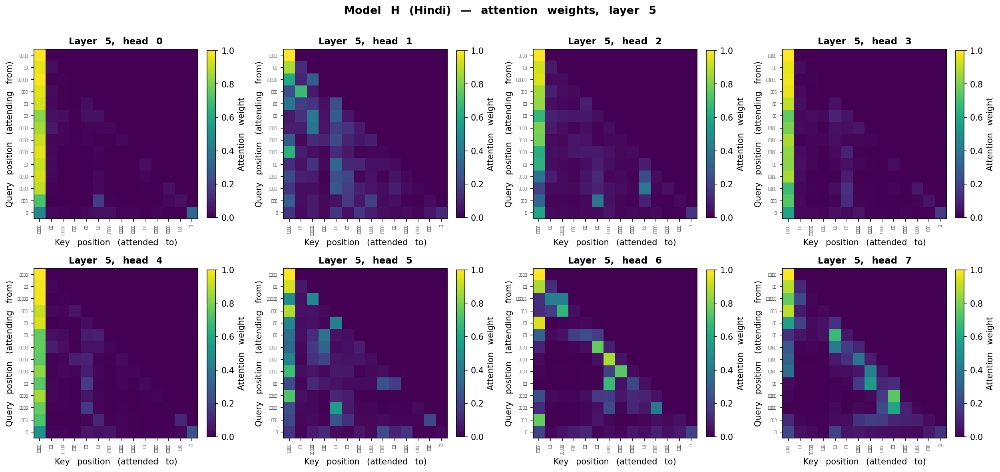
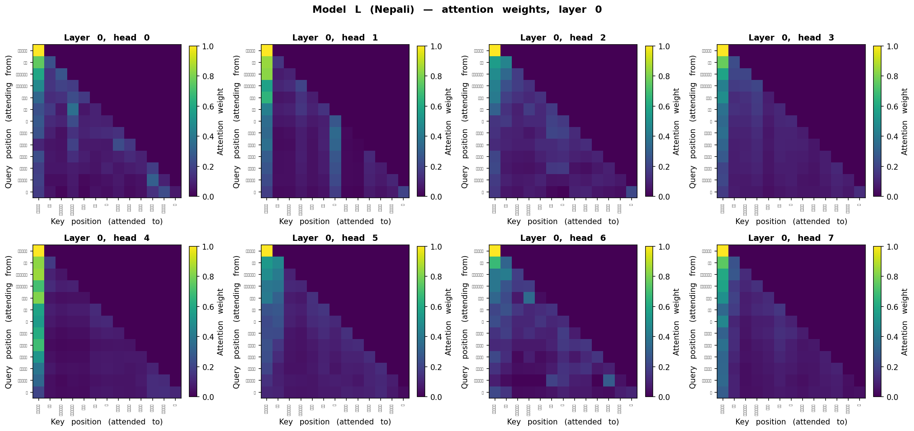
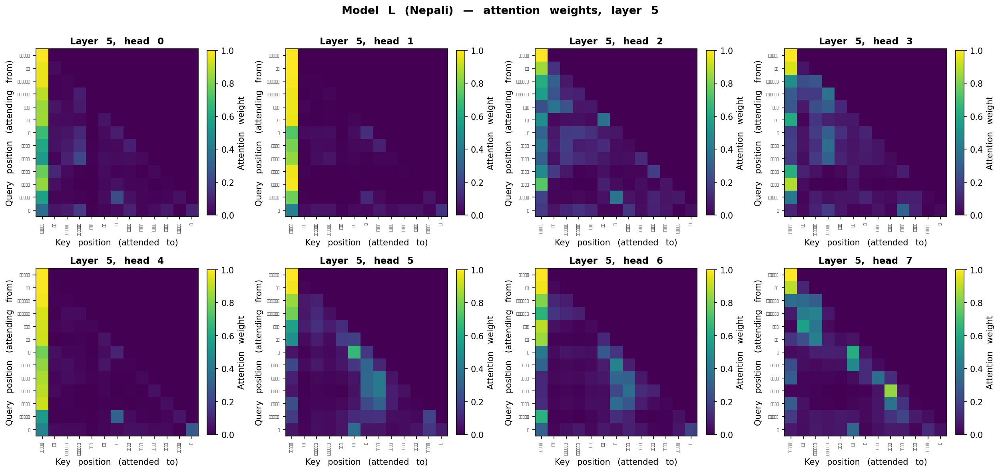
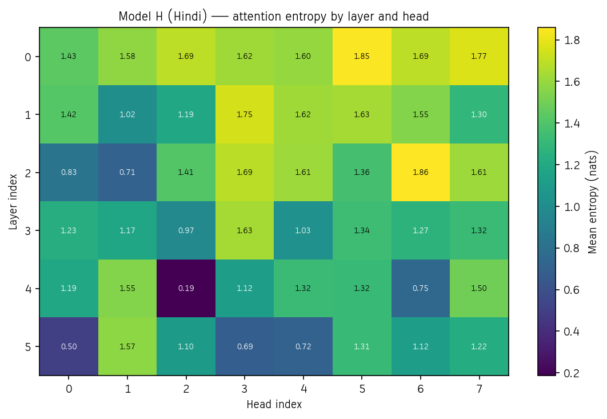
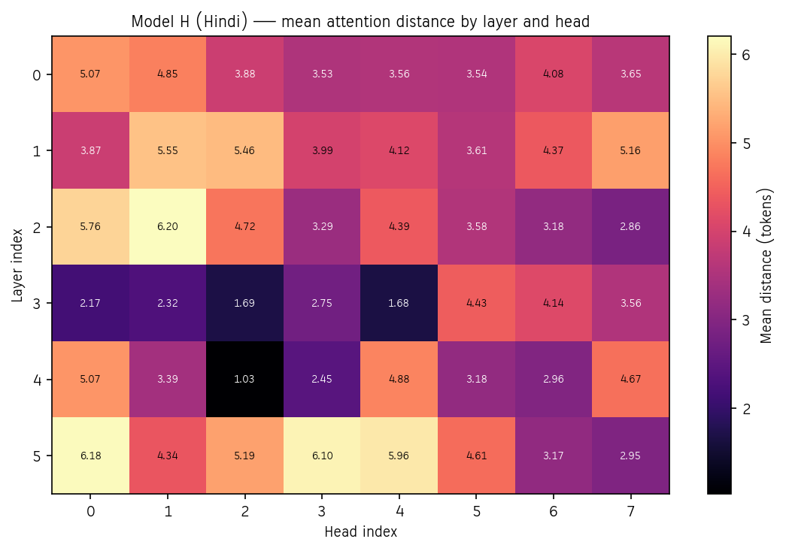
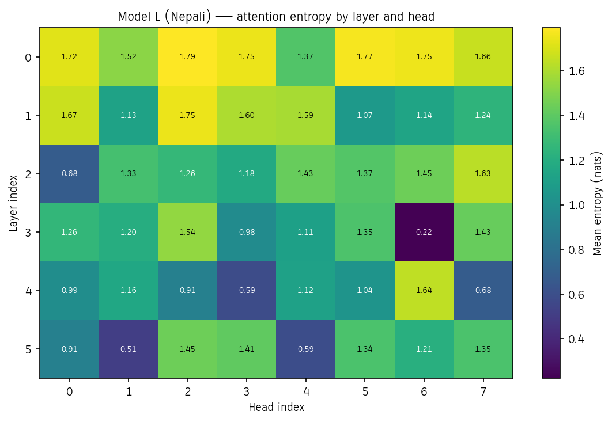
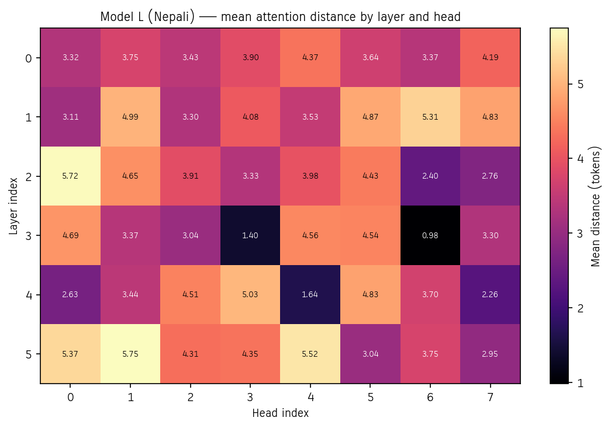
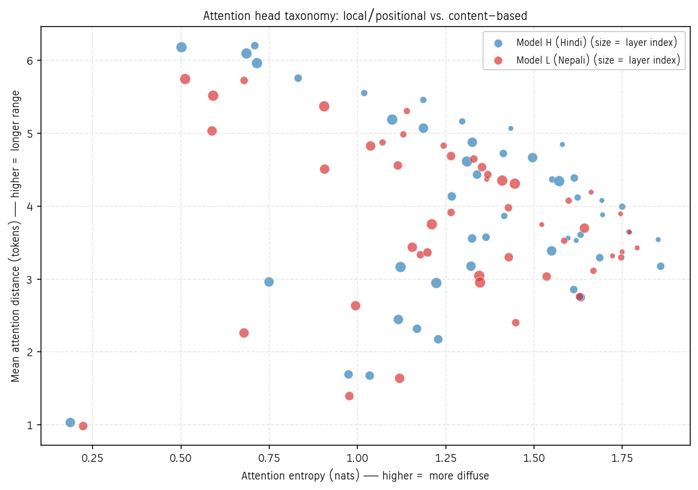

**Which heads are local and which are content-based.** Hindi has 11 local-sharp and 11 distant-diffuse heads against 13 and 13 in the two mixed categories; Nepali splits 9 / 9 against 15 / 15. Local-sharp heads — low entropy, short distance — behave positionally, attending to the immediately preceding token or two; the lower-triangular banding near the diagonal in the layer-0 heatmaps is this behaviour. Distant-sharp heads reach further back while staying selective, which is the signature of content-based attention.

**How the two models differ.** Model L's mean entropy is lower (1.267 vs. 1.311) and its mean attention distance shorter (3.84 vs. 3.98 tokens). Nepali's attention is thus slightly *sharper and more local* than Hindi's. This is consistent with the fertility result: because Nepali words fragment into more subword pieces, more of the predictive signal sits in the immediately adjacent pieces of the same word, and heads that resolve within-word structure are correspondingly more useful.

---

## 6. Resource-level comparison

### Table T7

| Dimension | Model H (Hindi) | Model L (Nepali) | Interpretation |
|---|---|---|---|
| Train tokens | 648,012,574 | 659,499,440 | near-identical — *not* the differentiator |
| Unique words (Phase 1) | 3,956,492 | 6,800,829 | Nepali morphologically richer |
| Tokenizer fertility | 1.3042 | 1.4394 | Nepali needs 10.4% more tokens per word |
| Validation perplexity | 26.21 | 41.52 | **+58.4%** — token space, tokenizer-dependent |
| Validation BPB | 0.4797 | 0.4635 | **-3.4%** — byte space, tokenizer-fair |

Confirmed on the held-out **test** split (never used for checkpoint selection): perplexity gap **+58.3%**, BPB gap **-3.3%** — the same reversal, so it is not an artifact of validation-set selection bias.

**Both corpora are ~650M tokens, so this is not a data-quantity
comparison** — Phase 1 over-delivered on both. The real resource asymmetry
is morphological. Nepali's higher fertility means that at an equal token
budget Model L sees less linguistic content, and its larger unique-word
inventory (6.80M vs. 3.96M surface forms) spreads probability mass over more
rare types.

The diagnostic the spec asks for resolves cleanly: **PPL_L > PPL_H while
BPB_L < BPB_H**, so the gap is a tokenizer/morphology artifact rather than a
modelling failure. A reader looking only at perplexity would wrongly
conclude the lower-resource model is substantially worse.

---

## 7. Reproduction

```bash
python hindi/train/count_params.py            # Table T2
python hindi/eval/verify_causal_masking.py    # Table T3
python hindi/train/pretrain.py                # resumes automatically
python hindi/eval/evaluate_lm.py --checkpoint hindi/checkpoints/best.pt
python hindi/eval/evaluate_generation.py --checkpoint hindi/checkpoints/best.pt
python hindi/eval/analyze_attention.py --checkpoint hindi/checkpoints/best.pt
python report/scripts/make_phase2_figures.py  # all figures
python report/scripts/build_phase2_report.py  # this report
python -m pytest tests/test_phase2.py -v      # 22 correctness gates
```

Replace `hindi` with `nepali` for Model L. Checkpoint Drive links are in the
top-level `README.md`.

---

## 8. Where automation substitutes for human judgment

Carrying forward the caveat from the Phase 1 report, since it still applies:

- **No fluent reader assessed the generated text.** The qualitative examples
  in §4 are presented as evidence of grammaticality, but neither a Hindi nor
  a Nepali speaker judged their fluency, factual coherence, or register.
  Character-level plausibility and metric scores are verified; content
  quality is not.
- **Attention head labels are statistical, not interpretive.** "Local" and
  "content-based" are assigned by median split on entropy and distance, not
  by inspecting what the heads actually attend to linguistically.
- **The decoding-setting comparison uses one prompt sample.** All four
  settings share the same 500 prompts, which makes them comparable to each
  other, but the absolute scores depend on that draw.
