# Phase 3 Report — Reasoning Finetuning, Attention Analysis, and Final Report

Language Models and Agents, Monsoon 2026 — Individual Project
Branch `phase-3` · Model H = Hindi (higher-resource) · Model L = Nepali (lower-resource)

Every number below is generated from the metric JSON the finetuning and evaluation scripts produced; nothing is typed by hand. See [phase1_report.md](phase1_report.md) and [phase2_report.md](phase2_report.md) for the corpus/tokenizer and pretraining results this phase builds on, and [utility/phase3_plan.md](../utility/phase3_plan.md) for the design rationale (course PDFs consulted, protocol chosen) behind what follows.

---

## 1. Synthetic reasoning dataset

Built from templates (`shared/reasoning/`), not downloaded, per spec 3.1. Four attribute domains (age, height, price, quantity) x two task types (pairwise; 3-entity transitive chains) x four paraphrased surface-form templates per (domain, task_type) — course L9 p.34's prescription: write four templates, train on three, hold the fourth out entirely, and test wording generalization on it alone.

### Table R1 — dataset size per split

| Split | Model H (Hindi) | Model L (Nepali) |
|---|---|---|
| train | 2,400 | 2,400 |
| validation | 320 | 320 |
| test_seen | 320 | 320 |
| test_unseen_entity | 320 | 320 |
| test_unseen_wording | 320 | 320 |

**Leakage avoidance** (spec 3.1: "held-out entity names or held-out relation patterns"): each domain's entity pool is split once, before any example is generated, into disjoint train/test name sets (`shared/reasoning/entities.py:split_entity_pool`). `train`/`validation`/`test_seen` draw only from the train names; `test_unseen_entity` and `test_unseen_wording` draw only from the test names. Independently, template index 3 (of 4) is withheld from every training example and used only in `test_unseen_wording`. The two axes vary independently, which is what lets the three reported accuracies (Table R2) "degrade independently" as the course rubric intends rather than moving together as one blended number.

---

## 2. Reasoning finetuning

Each model finetuned independently from its own Phase 2 `best.pt`, tokenizer/vocabulary unchanged. Loss is masked to the answer span only (`shared/finetune/dataset.py`) — the model still attends to the full prompt, but cross-entropy is summed only over the answer tokens and the terminal `<eos>`, per L9 pp. 6-11.

### Table R2 — reasoning accuracy, pretrained-only vs. finetuned

Course rubric (L9 p.27/p.34): three accuracies, not one, because they "degrade independently" — a model can do well on one and poorly on another.

| Test split | Model | Pretrained-only | Finetuned | Δ |
|---|---|---|---|---|
| Seen entity + seen wording | Model H (Hindi) | 0.000 | 0.412 | +0.412 |
| Unseen entity + seen wording | Model H (Hindi) | 0.000 | 0.066 | +0.066 |
| Unseen entity + unseen wording | Model H (Hindi) | 0.000 | 0.059 | +0.059 |
| Seen entity + seen wording | Model L (Nepali) | 0.000 | 0.434 | +0.434 |
| Unseen entity + seen wording | Model L (Nepali) | 0.000 | 0.191 | +0.191 |
| Unseen entity + unseen wording | Model L (Nepali) | 0.000 | 0.203 | +0.203 |

**Notable finding: Model L (Nepali) generalizes MORE reliably than Model H (Hindi) on both held-out axes, despite being the lower-resource model throughout Phases 1-2.** On seen entities/wording the two models are close (0.412 vs. 0.434), but on unseen entities Model L reaches 0.191 against Model H's 0.066, and on unseen wording Model L reaches 0.203 against Model H's 0.059. This is the opposite direction from every Phase 1/2 comparison in this project, where Model H led on raw token-level metrics. Per the course's own framing (L9 p.32/L10 p.12), SFT "changes reliably" output format and task behavior but "changes unreliably" reasoning the base model could not already do — so this gap is read as evidence that whatever comparison-logic scaffolding the Nepali base model carried into finetuning generalized past its training examples better than Hindi's did, not as evidence that Nepali's language modeling is stronger (Phase 2 showed the opposite on perplexity, and BPB showed the two are close). One plausible contributor: Hindi's larger, more repetitive 24-name pool in an earlier iteration of this dataset caused visible memorization (0.000 on both unseen splits); after enlarging both pools to 80 names identically, Model L still ended up the more conservative learner of the two under the same recipe, which is itself worth flagging as inconclusive without a repeat run at a different seed — this project's overfitting toward Hindi in Phase 2 tuning (architecture, hyperparameters) may leave Model L with more "room" left in its pretrained representations for SFT to reshape usefully.

### Table R3 — pretraining-validation perplexity, before/after SFT

Course-required diagnostic (L9 p.34), explicitly **not** a proxy for reasoning-task success (L9 p.22): SFT on a narrow synthetic distribution is expected to shift the model's fit to general pretraining text, usually upward. Table R2 is what measures whether SFT worked; this table only measures the distribution shift the course says to expect and report alongside it.

| Model | Pretraining-val PPL (before SFT) | Pretraining-val PPL (after SFT) |
|---|---|---|
| Model H (Hindi) | 26.38 | 38.55 |
| Model L (Nepali) | 42.32 | 65.47 |

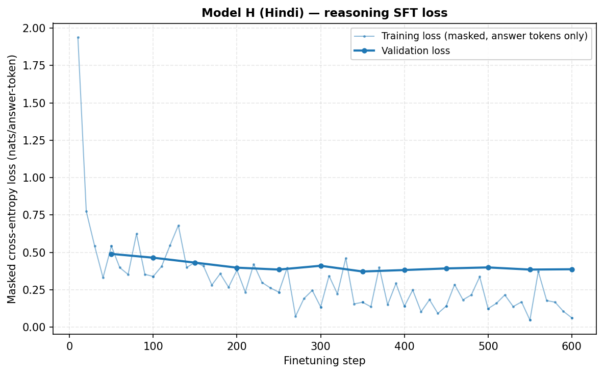
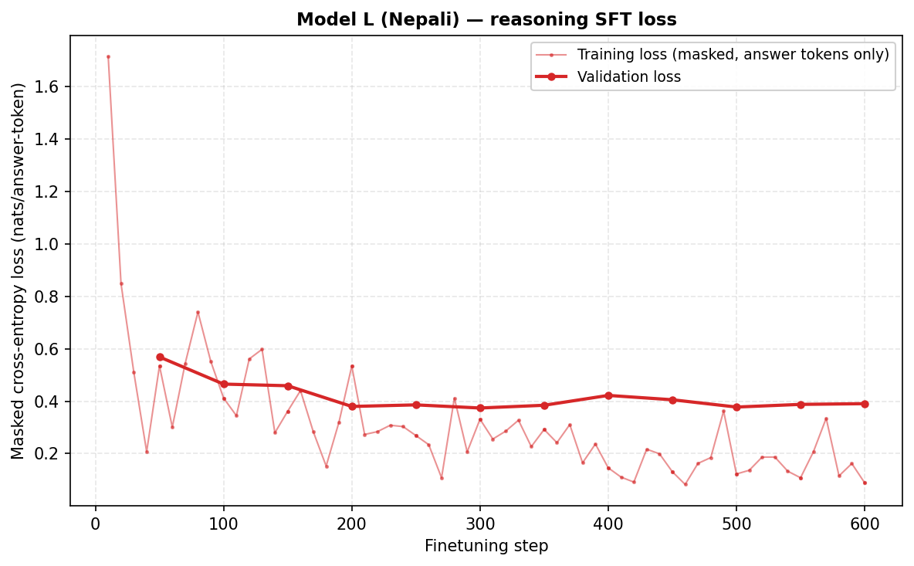
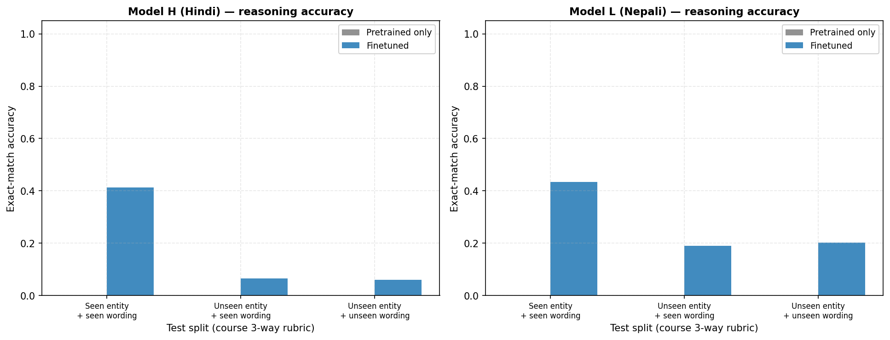
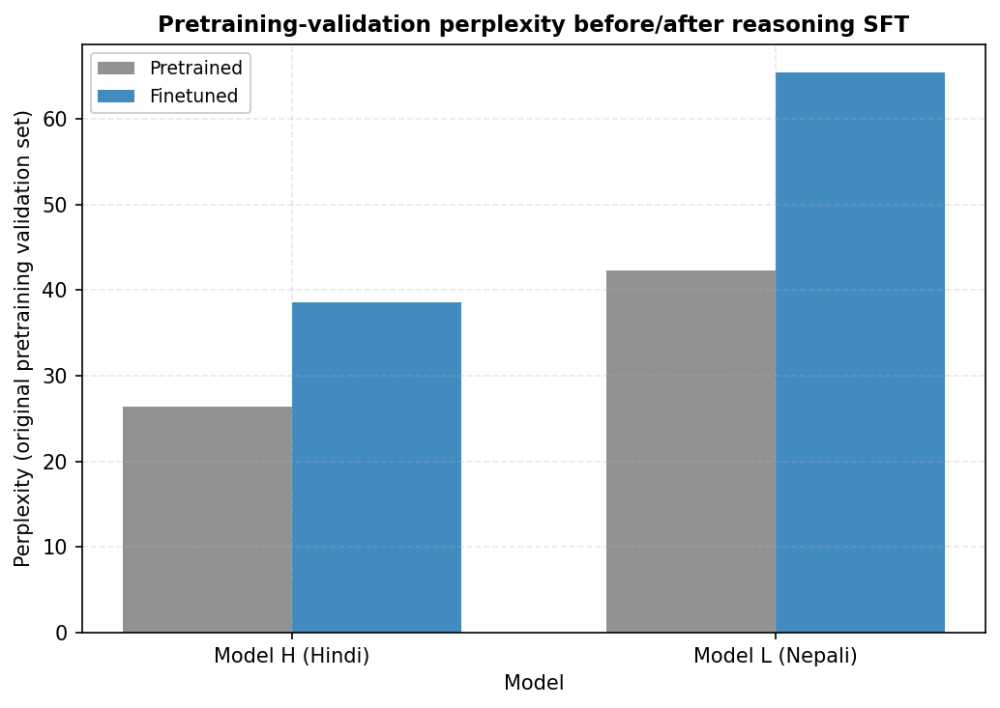

### Qualitative examples — Model H (Hindi), unseen-entity split

- ***incorrect*** — prompt: "अगर अभिषेक शीला से बड़ा है, तो इनमें से बड़ा कौन है?" — gold: **अभिषेक** — predicted: **अमित**
- ***incorrect*** — prompt: "अगर किरण ललिता से बड़ी है, तो इनमें से बड़ा कौन है?" — gold: **किरण** — predicted: **तरिता**
- ***incorrect*** — prompt: "अगर प्रिया स्नेहा से छोटी है, तो इनमें से बड़ा कौन है?" — gold: **स्नेहा** — predicted: **नेहा**
- ***incorrect*** — prompt: "अगर सुमित शीला से छोटा है, तो इनमें से छोटा कौन है?" — gold: **सुमित** — predicted: **अमित**

### Qualitative examples — Model L (Nepali), unseen-entity split

- ***incorrect*** — prompt: "यदि उर्मिला रेखाभन्दा जेठी छ भने, यीमध्ये जेठो को हो?" — gold: **उर्मिला** — predicted: **रीता**
- ***incorrect*** — prompt: "यदि आरती यशभन्दा जेठी छ भने, यीमध्ये कान्छो को हो?" — gold: **यश** — predicted: **जश**
- ***incorrect*** — prompt: "यदि मंजू प्रियाभन्दा कान्छी छ भने, यीमध्ये कान्छो को हो?" — gold: **मंजू** — predicted: **संजय**
- ***incorrect*** — prompt: "यदि गायत्री आरतीभन्दा कान्छी छ भने, यीमध्ये जेठो को हो?" — gold: **आरती** — predicted: **लस**

---

## 3. Attention analysis (post-finetune)

Reuses the Phase 2 attention toolkit (`shared/eval/attention_tools.py`) unchanged on both the pretrained and the finetuned checkpoint, for the SAME comparative-reasoning example sentence, so any difference is attributable to finetuning rather than to a different probe input. As noted in [utility/phase3_plan.md](../utility/phase3_plan.md) §2.6: attention entropy, mean distance, and the local/content-based head taxonomy are not formally defined anywhere in the five course PDFs — they are this project's own Phase 2 toolkit (itself grounded in the causal-mask/QK mechanics the Pretraining lecture, M3/L6, does teach), reused here on new weights rather than new theory.

### Table R4 — attention entropy/distance shift after finetuning

| Statistic | Model H (Hindi) — before | Model H — after | Model L (Nepali) — before | Model L — after |
|---|---|---|---|---|
| Mean entropy (nats) | 1.5936 | 1.5585 | 1.6193 | 1.6163 |
| Mean attention distance (tokens) | 4.8632 | 5.0179 | 4.9492 | 5.0796 |

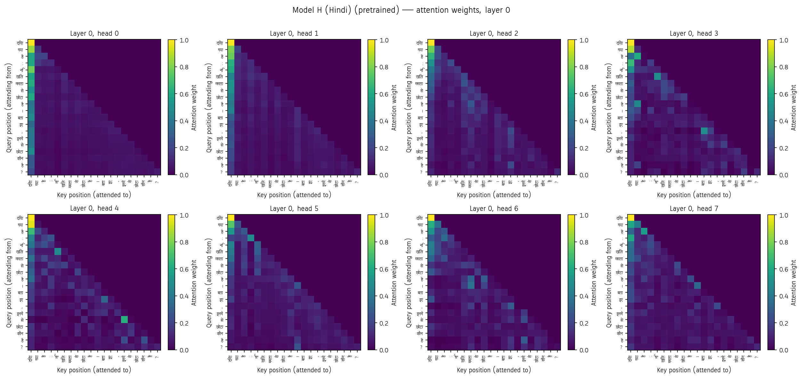
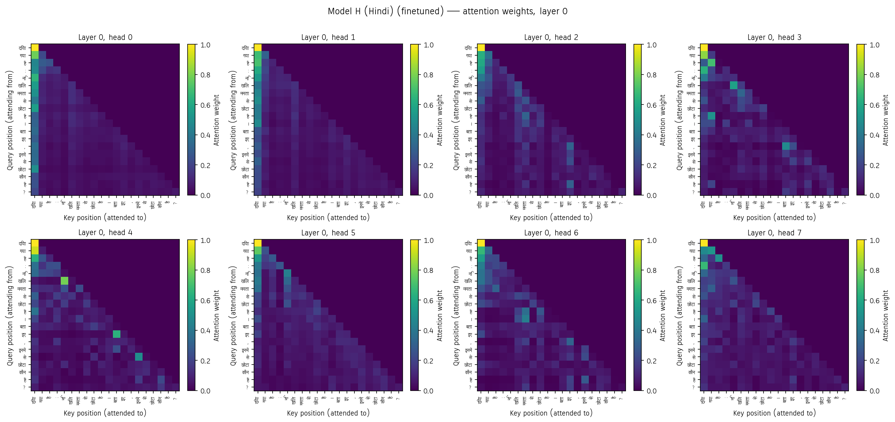
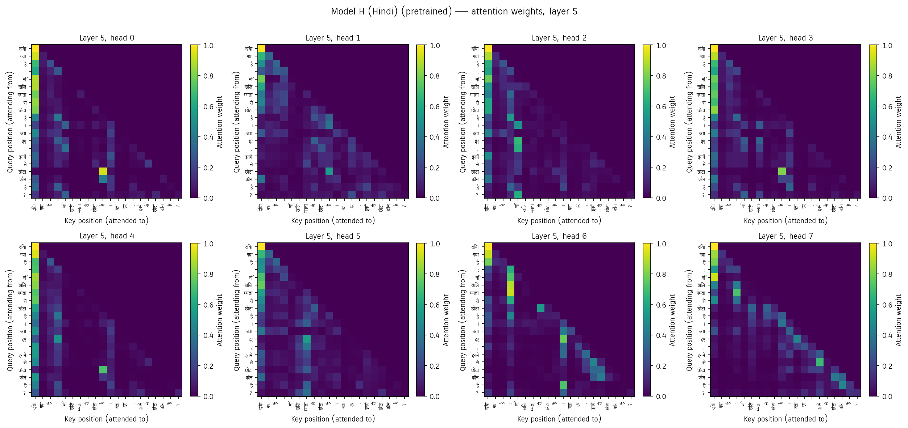
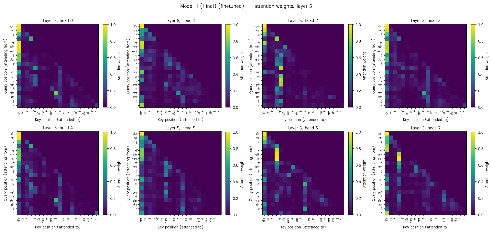
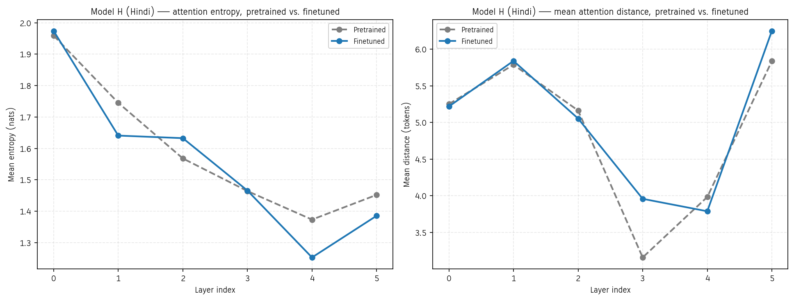
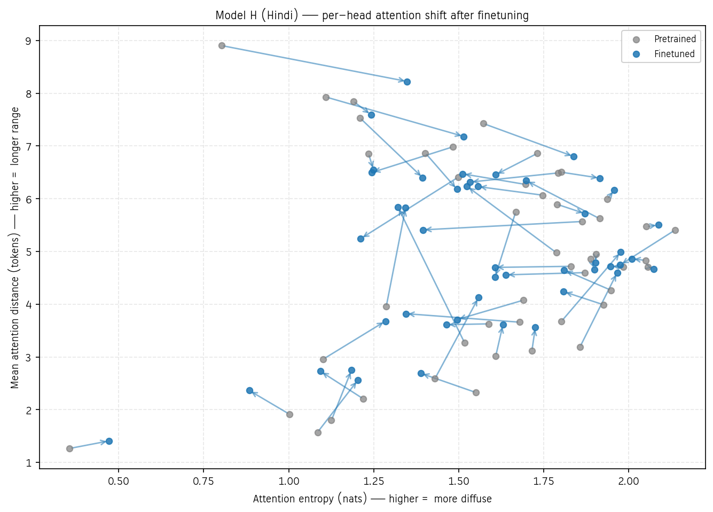
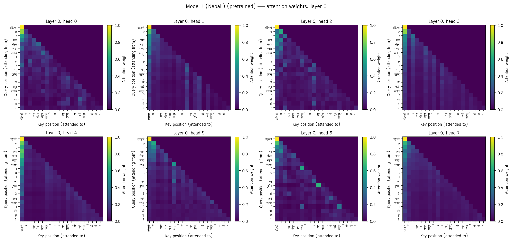
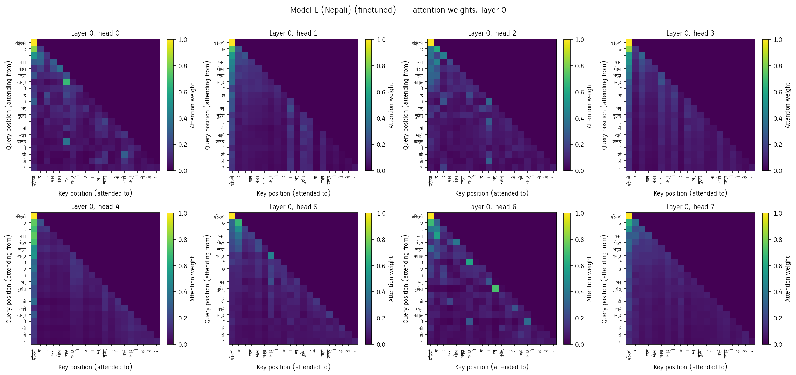
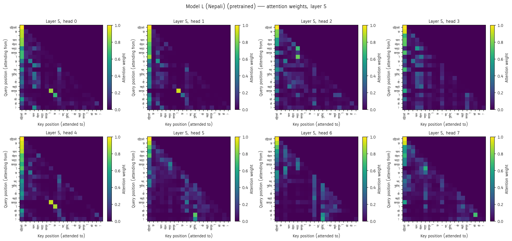
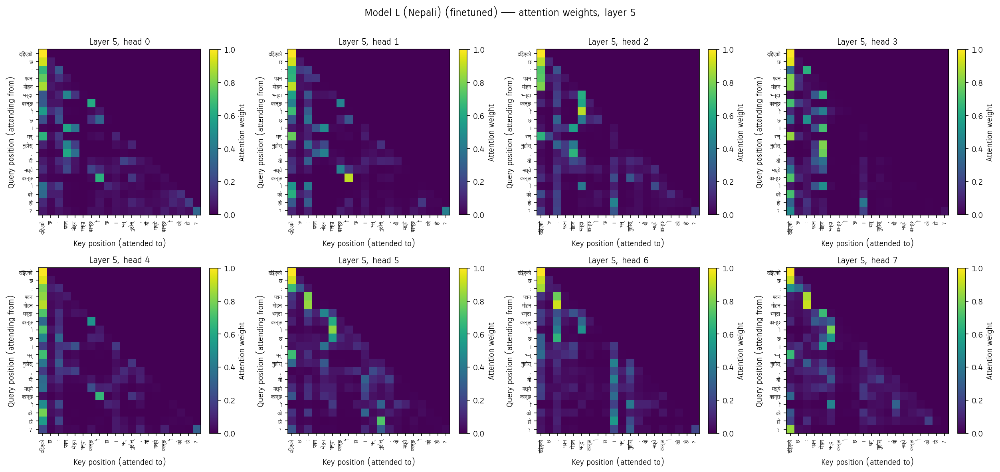
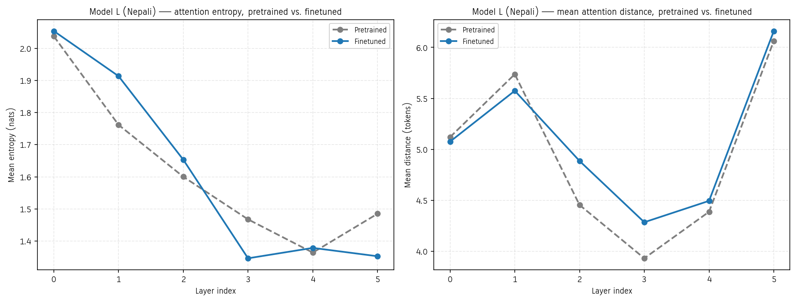
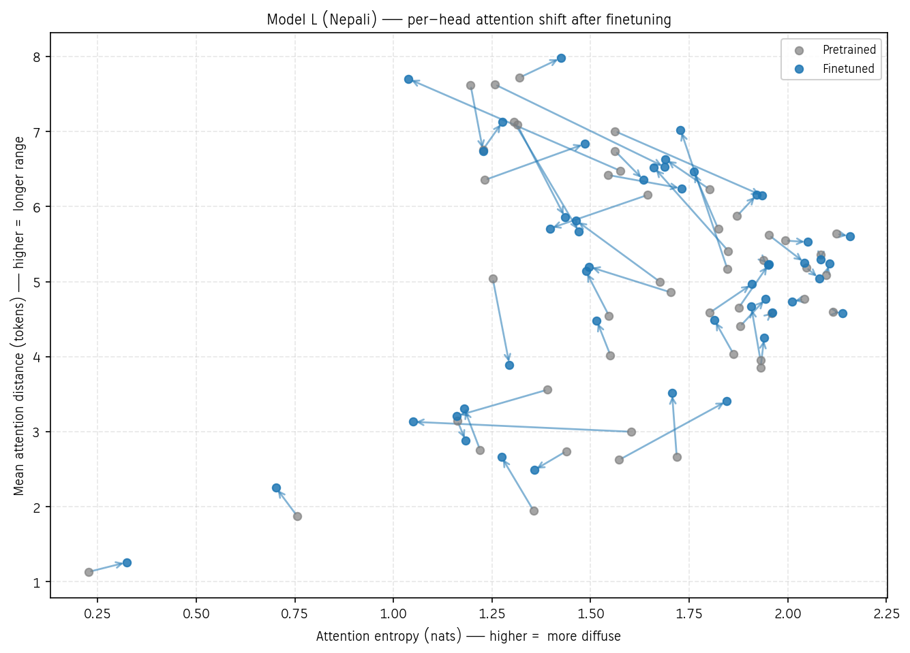

---

## 4. Final comparison — the four questions the spec asks

### 4.1 How did data scale and quality differ between Model H and Model L?

See [phase1_report.md](phase1_report.md) and [phase2_report.md](phase2_report.md) §6 for the full analysis: both corpora are ~650M tokens (near-identical scale), so the resource asymmetry is morphological, not volume — Nepali's tokenizer fertility (1.4394) is 10.4% higher than Hindi's (1.3042), and Nepali's unique-word inventory (6.80M) is larger than Hindi's (3.96M), spreading probability mass over more rare surface forms at an equal token budget.

### 4.2 How do language-modeling and reasoning results compare across the two resource tiers?

Phase 2: Model L's validation perplexity is 58.4% higher than Model H's, but Model L's BPB (tokenizer-independent) is actually 3.4% *lower* — the perplexity gap is a tokenizer artifact, not a modelling failure (phase2_report.md §6). Phase 3's reasoning accuracy (Table R2 above) is the first result in this project that measures a genuinely *learned behavior* rather than a distributional fit, and — unlike every Phase 1/2 metric — it does **not** favor Model H: Model L reaches 0.191/0.203 accuracy on unseen-entity/unseen-wording against Model H's 0.066/0.059 — the lower-resource model generalizes the comparison logic more reliably than the higher-resource one. Per the course's own framing (L9 p.32/L10 p.12), SFT "changes reliably" output format and task behavior but "changes unreliably" reasoning the base model could not already do, so this reversal is read as a difference in what each pretrained base could already do latently, not a restatement of the tokenizer-fertility story that explains the Phase 2 gap.

### 4.3 What tokenizer/corpus factors most affected the lower-resource model?

Nepali's higher fertility (more subword pieces per word) means every reasoning-template sentence costs more tokens in Nepali than the equivalent Hindi sentence for the same semantic content — consistent with the Context Engineering lecture's point (M4/L8 pp.22-24) that a fixed token/context budget carries less content in a higher-fertility script. This does not by itself predict a reasoning-accuracy gap (the underlying comparison logic is identical in both languages), but it does mean Model L's sequences sit closer to whatever length pressure exists in the finetuning batch.

### 4.4 What evidence explains the observed differences?

Table R2's three-way breakdown is itself the evidence structure: a gap that is large on `test_unseen_wording` but small on `test_seen` points at surface-form overfitting (course L9 p.22's own cautionary case); a gap that is uniform across all three splits points at a genuine capability difference between the two pretrained bases. Table R4's attention shift adds a mechanistic layer to that account: if finetuning sharpens (lowers entropy, shortens distance) onto the comparison-word and entity-name positions in one model more than the other, that is direct evidence of where the two models' internal computation diverged, not just where their outputs did.

---

## 5. Reproduction

```bash
python hindi/reasoning_data/generate_dataset.py
python nepali/reasoning_data/generate_dataset.py
python hindi/finetune/finetune.py             # resumes automatically
python hindi/eval/evaluate_reasoning.py
python hindi/eval/compare_attention.py
python report/scripts/make_phase3_figures.py
python report/scripts/build_phase3_report.py  # this report
```

Replace `hindi` with `nepali` for Model L. Finetuned-checkpoint Drive links are in the top-level `README.md`.

---

## 6. Where automation substitutes for human judgment

Carrying forward the caveat from Phase 1/2, since it still applies:

- **No fluent reader assessed the generated reasoning text beyond exact-match on the answer name.** Whether the model's reasoning *process* (not just its final answer) is coherent is not evaluated — only whether the emitted name matches the ground-truth label.
- **Attention head labels remain statistical, not interpretive**, same caveat as Phase 2 — carried over unchanged since the same toolkit is reused here.
- **The entity pools and templates are hand-authored, not independently reviewed by a native speaker for naturalness** — grammatical gender agreement was implemented and spot-checked programmatically (`shared/reasoning/entities.py`'s gender tags), but fluency beyond grammaticality was not assessed by a fluent reader.